# CLAUDE.md — bc-uml

Instrucciones de proyecto para Claude Code. Este archivo se carga automáticamente en cada sesión.

---

## Identidad del proyecto

- **Nombre:** bc-uml
- **Tipo:** Bootcamp técnico, 100% orientado a la práctica
- **Duración:** 10 semanas × 10 horas = 100 horas totales (Zero to Advanced)
- **Notación:** UML **2.5.1** (OMG). **Herramienta:** PlantUML **1.2026.9** en Docker (`compose.yaml`, servicio `uml`)
- **Sistema mínimo del estudiante:** Docker con Compose v2 (Linux, macOS o Windows con WSL2) y git
- **Repositorios de referencia de estructura:** ergrato-dev/bc-ssh y ergrato-dev/bc-tmux

## Audiencia objetivo

Desarrolladores con POO básica: saben qué es una clase, un objeto, un atributo, un método, herencia e interfaz en al menos un lenguaje (nivel de bc-oop-java o bc-python). Nunca modelaron con UML o solo copiaron diagramas sin entenderlos. No asumas UML; sí asume git, terminal básica y un lenguaje orientado a objetos.

## Filosofía de contenido: 100% práctica

- **Teoría mínima:** solo el contexto indispensable para no perderse en el lab. Máximo 45 min por semana.
- **Labs primero:** el estudiante aprende modelando, no leyendo.
- **Errores intencionados:** algunos labs incluyen diagramas rotos (sintaxis de PlantUML o errores de modelado: relaciones al revés, multiplicidades imposibles, clases dios) para que el estudiante los depure.
- **Progresión real:** cada semana construye sobre la anterior (ver proyecto hilo conductor).
- **Diagramas como código:** todo diagrama del estudiante es un `.puml` versionado con git; nada de herramientas de arrastrar y soltar.

## Proyecto hilo conductor: `modelo` del dominio asignado

El instructor asigna a cada aprendiz **un dominio** en la semana 01 (un sistema de negocio: clínica veterinaria, taller mecánico, etc.). A lo largo del bootcamp el aprendiz construye **el modelo UML completo de ese sistema**. Cada `3-proyecto/starter/` parte del resultado de la semana anterior; la semana 10 entrega el modelo completo y su defensa. Detalle en `docs/proyecto-hilo-conductor.md`.

```
modelo/
├── README.md            # dominio asignado, actores, glosario del dominio, índice de diagramas
├── diagramas/           # NN-nombre.puml, uno por diagrama
├── casos-de-uso/        # especificaciones CU-NN.md (semana 04)
└── codigo/              # esqueleto de clases en tu lenguaje POO (semana 09)
```

**Nunca** se publica el catálogo de dominios en este repo: vive en el repo privado `ergrato-dev/bc-dominios` (`catalogos/bc-uml.md`). Los textos para aprendices dicen que el dominio lo asigna el instructor.

## Distribución de tiempo por semana (10h)

| Sección | Tiempo | Descripción |
|---------|--------|-------------|
| 1-teoria | 45 min | Contexto mínimo + referencia rápida (1–3 archivos) |
| Conocimiento | 15 min | 10 preguntas de la rúbrica, respondidas por escrito |
| 2-practicas | 6h | 6 labs progresivos (~60 min c/u) |
| 3-proyecto | 3h | Proyecto semanal integrador (incremento del `modelo`) |

## Estructura de carpetas por semana

```
week-NN-nombre_del_tema/
├── README.md                  # Descripción, objetivos, tabla de contenidos, navegación
├── rubrica-evaluacion.md      # Conocimiento 30 / Desempeño 40 / Producto 30
├── checks.json                # Autograding (ver docs/autograding.md)
├── 0-assets/                  # Diagramas SVG escritos a mano, enlazados desde 1-teoria
│   └── NN-nombre.svg
├── 1-teoria/                  # Contexto mínimo, NO tutoriales largos
│   └── 01-contexto.md         # 1–3 archivos, ≤ 600 palabras de prosa c/u
├── 2-practicas/
│   ├── README.md              # Índice de labs con duración estimada
│   └── lab-NN-nombre/
│       ├── README.md          # Enunciado, paso a paso, criterios de éxito
│       └── starter/           # .puml con TODOs (renderiza aunque esté incompleto)
├── 3-proyecto/
│   ├── README.md              # Paso a paso + comprobaciones de checks.json
│   └── starter/               # modelo de la semana anterior + TODOs
├── 4-recursos/
│   ├── ebooks-free/README.md
│   ├── videografia/README.md
│   └── webgrafia/README.md
└── 5-glosario/
    └── README.md              # Término | Definición en una línea | Ejemplo
```

**Sin soluciones en este repo.** Ni `solucion/` en los labs ni en el proyecto, ni ignoradas por git. La solución del proyecto semanal vive en el repo privado `ergrato-dev/bc-instructor`, en `bc-uml/week-NN-slug/3-proyecto/`.

## Convenciones de naming

| Elemento | Convención | Ejemplo |
|----------|-----------|---------|
| Carpeta de semana | `week-NN-nombre_con_guion_bajo` | `week-02-diagrama_de_clases` |
| Carpeta de lab | `lab-NN-nombre-con-guion` | `lab-03-operaciones-y-parametros` |
| Diagrama del estudiante | `NN-nombre-kebab.puml` | `diagramas/02-clases.puml` |
| Clases, atributos, operaciones, estados, mensajes | **inglés** | `class Appointment`, `+ schedule(date: Date): void` |
| Actores y casos de uso | inglés | `actor Receptionist`, `(Book appointment)` |
| Lab con diagrama roto a propósito | nombre con `roto(s)`/`rota(s)` o `debug` | `lab-02-depurar-diagramas-rotos` |

## Estándares PlantUML en el repo

```plantuml
@startuml
' Título obligatorio: lo que muestra el diagrama, no el tipo de diagrama
title Reserva de citas — clases del dominio

' Sin skinparam de colores en los diagramas del estudiante: el tema por defecto
' se lee bien impreso y en pantalla. Solo se permite !theme en el lab de estilo.
' Estas tres líneas sí van en todo diagrama de clases u objetos: quitan lo que
' PlantUML añade y UML no define (círculo con letra, iconos de visibilidad).
hide circle
hide empty members
skinparam classAttributeIconSize 0

class Appointment {
  - id: UUID
  - startsAt: DateTime
  + reschedule(to: DateTime): void
}
@enduml
```



- Todo `.puml` empieza en `@startuml`, termina en `@enduml` y tiene `title`.
- Atributos con tipo siempre (`- name: String`); operaciones con parámetros tipados y tipo de retorno.
- Un diagrama, un archivo. Nada de varios `@startuml` en el mismo `.puml`.
- Los `.puml` de `starter/` **renderizan** aunque estén incompletos (`verificar-enlaces.sh` lo comprueba), salvo los labs rotos a propósito.
- Se renderiza siempre dentro del contenedor: `docker compose run --rm uml plantuml -tsvg ruta.puml`. Nunca la versión online de plantuml.com para el trabajo del estudiante: envía el diagrama a un servidor externo.
- Los SVG/PNG generados por el estudiante no se versionan (`.gitignore`); el `.puml` es la fuente.
- Notación UML estricta: si PlantUML permite algo que UML 2.5.1 no (p. ej. flechas sin tipo en un diagrama de clases), se usa la forma UML y se explica la diferencia.

## Estándares de idioma

- **Prosa, enunciados, comentarios:** español, siempre **tuteo** (tú, tienes, puedes, haz). **Nunca voseo** (vos, tenés, podés, hacé, mirá).
- **Nomenclatura técnica en inglés:** elementos del modelo (clases, atributos, operaciones, estados, mensajes, actores, casos de uso) y código. Siguen en español: carpetas del curso (`week-*`, `lab-*`), archivos `.md`, nombres de archivo `.puml` y el tooling del repo (`scripts/verificar-*.sh`).
- **Comentarios `'` en `.puml`, en español y solo donde hagan falta:** explican una decisión de modelado (por qué composición y no agregación), nunca repiten el diagrama.
- **Nunca mezclar idiomas en la misma línea de prosa.**

## Estructura de un lab (README.md de lab)

1. **Título y duración estimada**
2. **Objetivo** — una sola oración con el verbo en infinitivo
3. **Contexto** — máx. 3 párrafos o bullets; no repetir lo que ya está en 1-teoria
4. **Paso a paso** — pasos numerados con comandos exactos y el resultado esperado
5. **Criterios de éxito** — verificables (`plantuml -checkonly` sale con 0; el SVG muestra 3 clases con 2 atributos cada una)
6. **Reto extra** (opcional)

## Estándar paso a paso (labs y proyectos): no asumir nada

El estudiante nunca usó UML ni PlantUML. Cada paso se puede seguir sin adivinar:

1. **Paso 0**: `cd` a la carpeta del lab (ruta desde la raíz del repo) y cómo se abre el contenedor.
2. **Output tras cada comando**, incluido `; echo $?` cuando importa el código de salida. Sin salida: `(sin salida)`. Se pega de una ejecución real con PlantUML 1.2026.9, nunca de memoria.
3. **Un subpaso por TODO**: qué escribir, la sintaxis mínima de PlantUML, el comando que lo comprueba y qué debe verse en el SVG. Prohibido "Completa `starter/x.puml`" a secas.
4. **Ver el resultado**: todo paso que cambia un diagrama dice cómo se renderiza (`plantuml -tsvg`) y qué abrir (`starter/x.svg` en el navegador o en el editor).
5. **Errores esperados**: cuando un paso puede dar `Syntax Error?`, se muestra el mensaje real y la línea que lo causa.
6. **Todo criterio de éxito sale de un paso** que lo produce.
7. **Proyectos**: sección `## Paso a paso` que recorre los TODOs en orden, cada uno con su comprobación. Se trabaja sobre `3-proyecto/starter/` (es lo que corrige el autograding). Termina con `./scripts/verificar-semana.sh NN` y su output.
8. **Agnóstico de editor**: nada depende de un editor concreto; la extensión de PlantUML para VS Code se menciona como opcional.

## Estructura del README.md de semana

1. Título y número de semana
2. Descripción (2-3 oraciones)
3. Objetivos de aprendizaje (lista con verbos de acción)
4. Prerrequisitos
5. Tabla de contenidos con tiempos
6. Distribución del tiempo
7. Cómo verificar que completaste la semana (`./scripts/verificar-semana.sh NN`)
8. `## 🔗 Navegación` (anterior / actual / siguiente + volver al índice)

## Rúbrica de evaluación

Tres evidencias, **mínimo 70% en cada una** (no en el promedio):
- 🧠 Conocimiento 30%: 10 preguntas conceptuales (3 pts c/u) que piden explicar el porqué de una decisión de modelado, no recordar notación
- 💪 Desempeño 40%: los 6 labs, con criterios de éxito verificables
- 📦 Producto 30%: proyecto semanal — 60 pts de autograding (`checks.json`) + 40 pts de calidad (fidelidad al dominio asignado, nombres del dominio, notación UML correcta, comentarios del porqué)

Bandas: Sobresaliente 90–100, Notable 80–89, Aprobado 70–79.

## Plan de 10 semanas

Índice con estado: `bootcamp/README.md` (✅ = semana al estándar actual).

| Semana | Carpeta | Tema | Proyecto semanal (`modelo`) |
|--------|---------|------|-----------------|
| **Fase 1 — Estructura** ||||
| 01 | `week-01-fundamentos_uml_y_plantuml` | Para qué modelar, taxonomía UML 2.5.1, PlantUML en Docker, diagramas como código, modelo conceptual | `README.md` del dominio + `01-modelo-conceptual.puml` |
| 02 | `week-02-diagrama_de_clases` | Compartimentos, visibilidad, tipos, multiplicidad de atributos, operaciones, `{static}`/`{abstract}`, enum, interfaz | `02-clases.puml` con atributos y operaciones |
| 03 | `week-03-relaciones_y_diagrama_de_objetos` | Asociación, navegabilidad, multiplicidad, agregación, composición, generalización, realización, dependencia, clase asociación, objetos | Relaciones en `02-clases.puml` + `03-objetos.puml` |
| **Fase 2 — Comportamiento** ||||
| 04 | `week-04-casos_de_uso` | Actores, casos de uso, límite del sistema, `include`/`extend`, generalización, especificación textual | `04-casos-de-uso.puml` + `casos-de-uso/CU-NN.md` |
| 05 | `week-05-diagrama_de_actividades` | Acciones, decisiones, fork/join, particiones, objetos, señales | `05-actividad-<proceso>.puml` |
| 06 | `week-06-secuencia_y_comunicacion` | Lifelines, mensajes síncronos/asíncronos, creación/destrucción, `alt`/`opt`/`loop`/`par`/`ref`, comunicación | `06-secuencia-<cu>.puml` + comunicación |
| 07 | `week-07-maquinas_de_estados` | Estados, transiciones `evento [guarda] / acción`, entry/exit/do, compuestos, historia | `07-estados-<entidad>.puml` |
| **Fase 3 — Arquitectura y código** ||||
| 08 | `week-08-componentes_paquetes_y_despliegue` | Paquetes y dependencias, componentes e interfaces provistas/requeridas, despliegue, artefactos | `08-paquetes`, `08-componentes`, `08-despliegue` |
| 09 | `week-09-de_uml_a_codigo_y_patrones` | Diagrama → código y código → diagrama, patrones GoF en UML (Strategy, Observer, Factory, Adapter) | `codigo/` + `09-patron-<nombre>.puml` |
| 10 | `week-10-proyecto_integrador` | Coherencia entre vistas, trazabilidad, revisión por pares, defensa | Modelo completo + defensa |

Versiones del stack: `docs/stack-versions.md`. No usar otras. Mermaid no se usa (ni en labs ni en teoría). Python, si alguna vez hiciera falta, siempre con **uv**; Node.js siempre con **pnpm**.

## Autograding con PlantUML

Cada check corre dentro del contenedor `uml` y es **agnóstico del dominio**: comprueba tipo de diagrama, que renderiza y cantidades/notación, nunca nombres concretos de clases. Contrato completo en `docs/autograding.md`.

```bash
plantuml -checkonly {proyecto}/diagramas/02-clases.puml        # renderiza
plantuml -syntax < {proyecto}/diagramas/02-clases.puml         # imprime CLASS y "(N entities)"
```

## Comandos útiles durante el desarrollo del bootcamp

```bash
docker compose build                                 # imagen del laboratorio
./scripts/verificar-enlaces.sh                       # estructura, enlaces, starters que renderizan
./scripts/generar-navegacion.sh NN                   # tabla anterior/siguiente al pie de cada documento
./scripts/verificar-semana.sh NN                     # autograding de una semana
PROYECTO=../bc-instructor/bc-uml/week-NN-slug/3-proyecto ./scripts/verificar-semana.sh NN
                                                     # valida la solución del instructor
docker compose run --rm uml plantuml -tsvg ruta.puml # renderiza un diagrama
```

## Contenido esperado por sección

### 0-assets/
Diagramas en **SVG escrito a mano**, un archivo por diagrama, nombrado `NN-nombre-descriptivo.svg` en orden de lectura. **Sin cupo por semana: los que pida el contenido.** Un SVG entra cuando muestra algo que un `.puml` de ejemplo no muestra bien (una taxonomía, una comparación lado a lado, una anatomía anotada); un diagrama UML de ejemplo se escribe como bloque `plantuml` en la teoría, no como SVG. **Nada de Mermaid ni arte ASCII.**

- **Todo SVG se enlaza desde el archivo de `1-teoria/` donde aparece el concepto**, con `../0-assets/NN-nombre.svg`. El texto alternativo describe lo que muestra. `verificar-enlaces.sh` falla con SVG huérfanos.
- `viewBox` obligatorio, sin `width`/`height` fijos en la raíz.
- `role="img"` y `<title>` descriptivo como primer hijo.
- `<rect>` de fondo `#0d1117` que cubra el `viewBox`.
- Sin degradados, sin `foreignObject`, sin fuentes externas. Texto ≥ 12 px.
- Prosa: `font-family="Inter, system-ui, -apple-system, sans-serif"`. Código: `ui-monospace, SFMono-Regular, Menlo, monospace`.

Paleta (GitHub dark + morado UML del header `assets/bootcamp-header.svg`):

| Rol | Hex |
|-----|-----|
| Lienzo | `#0d1117` |
| Superficie (cajas) | `#161b22` |
| Borde | `#30363d` |
| Texto principal | `#f0f6fc` |
| Texto secundario | `#8b949e` |
| Acento UML (elemento principal) | `#a371f7` |
| Azul (estructura, clases) | `#58a6ff` / `#79c0ff` |
| Verde (comportamiento, correcto) | `#3fb950` |
| Naranja (relaciones, énfasis) | `#f78166` |
| Amarillo (aviso) | `#e3b341` |
| Rojo (error) | `#f85149` |

### 4-recursos/
- `ebooks-free/`: `| Título | Formato | Descripción | Enlace |`, mínimo 2.
- `videografia/`: `| Título | Canal | Duración | Enlace |`, mínimo 3; en español si existe con calidad.
- `webgrafia/`: `| Recurso | Descripción |`, 3–5, priorizando la especificación UML 2.5.1 (omg.org) y la referencia de PlantUML.

Solo enlaces comprobados al escribir la semana; nada inventado. Los videos se comprueban con oEmbed (`https://www.youtube.com/oembed?url=...`): YouTube responde 200 aunque el video no exista.

### 5-glosario/
`| Término | Definición en una línea | Ejemplo |`, entre 8 y 15 términos nuevos de esa semana.

## Notas para Claude al generar contenido

- Soluciones: la del proyecto semanal se escribe en `../bc-instructor/bc-uml/week-NN-slug/3-proyecto/` y se valida con `PROYECTO=... ./scripts/verificar-semana.sh NN`. En `bc-instructor` se hace commit solo de `bc-uml`: `git add bc-uml && git commit -m "..." -- bc-uml`. Los labs no llevan solución.
- Cada semana nueva lleva `checks.json` escrito antes que el contenido y pasa `./scripts/verificar-enlaces.sh`.
- Al generar teoría, máximo 600 palabras por archivo. Preferir un `.puml` concreto sobre explicaciones abstractas. Todo ejemplo se puede pegar y renderiza con PlantUML 1.2026.9.
- Los ejemplos de teoría y labs usan dominios genéricos (biblioteca, tienda, cine). Nunca un dominio del catálogo de `bc-dominios`.
- No generar contenido de semanas futuras si no se pidió explícitamente. Los rediseños avanzan en bloques de 5 semanas por sesión.
- Revisar voseo antes de cerrar una semana: `grep -rnwE 'vos|tenés|podés|hacé|querés|sabés|usá|mirá|probá|escribí' bootcamp` debe salir vacío.
- Tono: directo, sin relleno, orientado al profesional.
