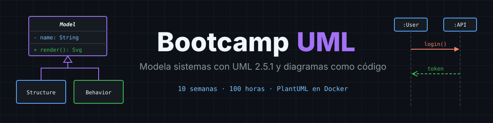

<div align="center">



[](https://www.omg.org/spec/UML/2.5.1/)
[](https://plantuml.com/)
[](/)
[](/)
[](/)
[](docs/setup-entorno.md)

**Modela sistemas de software con UML: de tu primer diagrama de clases a un modelo completo que puedes defender y llevar a código**

[🚀 Comenzar](#-inicio-rápido) •
[📚 Contenido](#-contenido-del-bootcamp) •
[💻 Requisitos](#-requisitos) •
[📖 Recursos](#-recursos)

</div>

---

## 🎯 ¿Qué es este Bootcamp?

Un bootcamp de **10 semanas** (10 h/semana, 100 h) para desarrolladores que ya programan con orientación a objetos y quieren diseñar, comunicar y documentar sistemas con **UML 2.5.1**. Todos los diagramas se escriben como código con **PlantUML**, se versionan con git y se renderizan en un contenedor Docker con la misma versión para todos.

- **100% práctico:** 45 min de teoría, 6 labs y un proyecto por semana.
- **Proyecto hilo conductor:** el instructor te asigna un dominio y cada semana añades una vista del modelo de ese sistema.
- **Autograding:** `./scripts/verificar-semana.sh NN` te dice qué te falta antes de entregar.

---

## 📚 Contenido del Bootcamp

Índice completo con estado: [bootcamp/README.md](bootcamp/README.md).

| Fase | Semanas | Temas |
|---|---|---|
| 1 — Estructura | 01-03 | Fundamentos y PlantUML, diagrama de clases, relaciones y objetos |
| 2 — Comportamiento | 04-07 | Casos de uso, actividades, secuencia y comunicación, máquinas de estados |
| 3 — Arquitectura y código | 08-10 | Componentes, paquetes y despliegue; de UML a código y patrones; proyecto integrador |

Cada semana:

| Sección | Tiempo |
|---|---|
| `1-teoria/` | 45 min |
| Conocimiento (10 preguntas) | 15 min |
| `2-practicas/` (6 labs) | 6 h |
| `3-proyecto/` | 3 h |

Evaluación: Conocimiento 30% · Desempeño 40% · Producto 30%, con mínimo 70% en cada una.

---

## 💻 Requisitos

- Programar con orientación a objetos en algún lenguaje (clases, objetos, herencia, interfaces).
- Docker con Compose v2, git y jq. Guía: [docs/setup-entorno.md](docs/setup-entorno.md).

---

## 🚀 Inicio Rápido

```bash
git clone https://github.com/ergrato-dev/bc-uml.git
cd bc-uml
docker compose build
docker compose run --rm uml plantuml -version
./scripts/verificar-semana.sh --doctor
```

Empieza por la [Semana 01](bootcamp/week-01-fundamentos_uml_y_plantuml/README.md).

---

## 📁 Estructura del Repositorio

```
bc-uml/
├── bootcamp/          # Las 10 semanas + índice (README.md)
├── docs/              # Setup, autograding, proyecto hilo conductor, versiones
├── lab/Dockerfile     # Imagen con PlantUML 1.2026.9, Java 21 y Graphviz
├── compose.yaml       # Servicio uml
├── scripts/           # verificar-semana.sh, verificar-enlaces.sh, generar-navegacion.sh
└── assets/            # Header del bootcamp
```

### Estructura de cada Semana

```
week-NN-tema/
├── README.md              # Objetivos, contenido, navegación
├── rubrica-evaluacion.md  # Conocimiento / Desempeño / Producto
├── checks.json            # Autograding del proyecto
├── 0-assets/              # Diagramas SVG de la teoría
├── 1-teoria/
├── 2-practicas/           # 6 labs con starter/
├── 3-proyecto/            # Incremento del modelo de tu dominio
├── 4-recursos/
└── 5-glosario/
```

---

## 📖 Recursos

- [Especificación UML 2.5.1 (OMG)](https://www.omg.org/spec/UML/2.5.1/)
- [Referencia del lenguaje PlantUML](https://plantuml.com/)
- [UML Distilled, Martin Fowler](https://martinfowler.com/books/uml.html)

---

## 🤝 Contribuir

Los pull requests externos se cierran automáticamente. Si encuentras un error, abre un issue. Vulnerabilidades: [SECURITY.md](SECURITY.md). Convivencia: [CODE_OF_CONDUCT.md](CODE_OF_CONDUCT.md).

---

## ⚠️ Exención de Responsabilidad

Este material es de carácter **educativo y sin fines de lucro**. Los ejemplos, diagramas y proyectos incluidos son ficticios y tienen únicamente propósitos de aprendizaje.

- El contenido se proporciona **"tal cual"**, sin garantías de ningún tipo, explícitas o implícitas.
- Los autores no asumen ninguna responsabilidad por el uso que se dé a este material en entornos de producción.
- **UML** es una marca registrada del Object Management Group (OMG). Este proyecto no tiene afiliación oficial con OMG ni con ninguna organización certificadora.
- Las herramientas y recursos de terceros mencionados están sujetos a sus propios términos de licencia.

---

## 📄 Licencia

[CC BY-NC-SA 4.0](LICENSE). English version: [README_EN.md](README_EN.md).

---

<div align="center">

**Bootcamp UML: De Zero a Hero**

[](https://github.com/ergrato-dev/bc-uml)
[](https://github.com/ergrato-dev/bc-uml)

_10 semanas • 100 horas • Zero to Advanced_

</div>
