# PLANTILLA DE SEMANA — bc-uml

> Archivo de referencia. Copia esta estructura al crear contenido nuevo.
> Reglas completas en `CLAUDE.md`; plantilla de referencia, sin generador automático.

---

## README.md de semana (plantilla)

~~~markdown
# Semana NN — Título del Tema

## Descripción

<2-3 oraciones. Qué aprenderá el estudiante. Por qué importa en la práctica real.>

## Objetivos de aprendizaje

Al terminar esta semana, podrás:

- Escribir <concepto> usando <técnica>
- Depurar <problema común> con <herramienta>
- Construir <artefacto concreto> desde cero

## Prerrequisitos

- Semanas 01–NN-1 completadas
- El laboratorio Docker (`docker compose build`, ver docs/setup-entorno.md)
- <herramienta específica si aplica>

## Contenido

| # | Tipo | Tema | Tiempo |
|---|------|------|--------|
| — | Teoría | [01-contexto.md](1-teoria/01-contexto.md) | 45 min |
| — | Conocimiento | [10 preguntas](rubrica-evaluacion.md#-conocimiento-30) | 15 min |
| 1 | Lab | [lab-01-nombre](2-practicas/lab-01-nombre/) | 60 min |
| 2 | Lab | [lab-02-nombre](2-practicas/lab-02-nombre/) | 60 min |
| 3 | Lab | [lab-03-nombre](2-practicas/lab-03-nombre/) | 60 min |
| 4 | Lab | [lab-04-nombre](2-practicas/lab-04-nombre/) | 60 min |
| 5 | Lab | [lab-05-nombre](2-practicas/lab-05-nombre/) | 60 min |
| 6 | Lab | [lab-06-nombre](2-practicas/lab-06-nombre/) | 60 min |
| — | Proyecto | [Proyecto semanal](3-proyecto/) | 3 h |

**Total: 10 horas**

## Distribución del tiempo

```
[45 min] Leer 1-teoria/
[15 min] Responder las 10 preguntas de Conocimiento
[60 min] lab-01 — <tema>
...
[60 min] lab-06 — <tema>
[3 h]    Proyecto: <nombre>
```

## Verificación de completitud

Desde la raíz del repositorio:

```bash
./scripts/verificar-semana.sh NN
```

## 🔗 Navegación

| Anterior | Actual | Siguiente |
|---|---|---|
| [Semana NN-1 — Tema](../week-NN-1-slug/README.md) | **Semana NN — Tema** | [Semana NN+1 — Tema](../week-NN+1-slug/README.md) |

[← Volver al índice del bootcamp](../README.md)
~~~

---

## README.md de lab (plantilla)

~~~markdown
# Lab NN — Título del Lab

⏱ Duración estimada: ~60 min

## Objetivo

<Verbo en infinitivo> <qué> usando <qué notación UML>.

## Contexto

<Máx. 3 párrafos o 5 bullets. Referencia al tema de la semana sin repetir la teoría.>

## Paso a paso

0. Desde la raíz del repositorio, entra en la carpeta del lab:

   ```bash
   cd bootcamp/week-NN-slug/2-practicas/lab-NN-nombre
   ```

   Los comandos de `plantuml` se ejecutan dentro del contenedor. Ábrelo desde la raíz del repo:

   ```bash
   cd "$(git rev-parse --show-toplevel)"
   docker compose run --rm uml bash
   cd bootcamp/week-NN-slug/2-practicas/lab-NN-nombre
   ```

1. Renderiza el starter tal como está:

   ```bash
   plantuml -tsvg starter/diagrama.puml; echo $?
   ```

   Output:

   ```
   0
   ```

   Abre `starter/diagrama.svg` en el navegador: muestra <qué se ve>.

2. **TODO 1** de `starter/diagrama.puml`: <qué escribir>. Sintaxis:

   ```plantuml
   <fragmento mínimo>
   ```

   Comprueba:

   ```bash
   plantuml -checkonly starter/diagrama.puml; echo $?
   ```

   Output: `0`. Vuelve a renderizar: el SVG muestra <qué cambió>.

## Criterios de éxito

- [ ] `plantuml -checkonly starter/diagrama.puml` sale con `0`
- [ ] El SVG muestra <hecho verificable: N clases, M relaciones, etc.>

## Reto extra

<Opcional: extensión para quien termina antes.>
~~~

---

## starter .puml (plantilla)

```plantuml
@startuml
' Lab NN — Título
' Renderiza: plantuml -tsvg starter/diagrama.puml
title <Qué muestra el diagrama>

' TODO 1: <qué añadir y por qué>.
'         Comprueba: plantuml -checkonly starter/diagrama.puml  ->  sale con 0

@enduml
```



Los labs no llevan solución en este repositorio.
