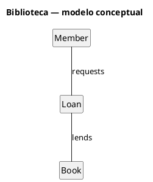

# Para qué modelar

## Un modelo es una simplificación con propósito

Un modelo deja fuera casi todo para que se vea una sola cosa. Un plano eléctrico no muestra el color de las paredes; un diagrama de clases no muestra cómo se guarda nada en disco. Si un diagrama intenta mostrar todo, no muestra nada.

**UML** (Unified Modeling Language) es una **notación**, no un método: define qué significa cada caja, línea y flecha, pero no te dice en qué orden diseñar. Lo mantiene el OMG (Object Management Group); la versión vigente es **UML 2.5.1** (2017).

## Tres formas de usar UML

| Modo | Para qué | Nivel de detalle | Vida útil |
|---|---|---|---|
| **Boceto** | Pensar y discutir un diseño en equipo | Solo lo que se discute | Horas o días |
| **Plano** | Documentar un diseño que otro va a construir o mantener | Completo en lo que importa | Lo que viva el sistema |
| **Lenguaje de programación** | Generar código desde el modelo | Total | Lo que viva el modelo |

En este bootcamp trabajas en modo **boceto y plano**: diagramas que sirven para pensar y que se versionan junto al código. La generación completa de código desde UML existe, pero casi nadie la usa fuera de nichos.

## Cuándo merece la pena

- **Antes de programar algo difícil:** dibujar 6 clases y sus relaciones cuesta 10 minutos; descubrir el error después de escribir 2000 líneas cuesta días.
- **Para hablar con quien no lee tu código:** un caso de uso o una actividad se discute con alguien de negocio.
- **Para que alguien nuevo entienda el sistema:** un diagrama de componentes y uno de despliegue ahorran semanas de arqueología.
- **Para decidir entre dos diseños:** dos diagramas lado a lado se comparan mejor que dos ramas de git.

## Cuándo no

- Para repetir lo que el código ya dice con claridad (un CRUD de 3 clases).
- Para cumplir un trámite: un diagrama que nadie lee es deuda.
- Para mostrar todos los detalles: getters, setters y cada atributo técnico tapan lo importante.

## Perspectivas de un mismo diagrama

Un diagrama de clases se puede leer desde tres perspectivas, y conviene decir cuál usas:

1. **Conceptual:** conceptos del dominio y cómo se relacionan. Sin tipos ni operaciones. Es lo que harás esta semana.
2. **Especificación:** responsabilidades e interfaces (qué hace cada clase).
3. **Implementación:** cómo queda en un lenguaje concreto.

## Diagramas como código

En este bootcamp no arrastras cajas: escribes texto en **PlantUML** y una herramienta dibuja el diagrama.

Ventajas para un equipo de desarrollo:

- El `.puml` se versiona con git: ves qué cambió con `git diff` y lo revisas en un pull request.
- Nadie pierde tiempo alineando cajas: el layout lo calcula la herramienta.
- El diagrama vive junto al código que describe.

El precio: controlas poco el layout. Cuando el layout importa más que el contenido, un diagrama a mano sigue siendo válido; en este bootcamp manda el contenido.

<!-- nav -->
---

## 🔗 Navegación

| Anterior | Siguiente |
|---|---|
| ← [Semana 01 — Fundamentos de UML y PlantUML](../README.md) | [Teoría — Taxonomía de UML](02-taxonomia-uml.md) → |

[↑ Semana 01](../README.md)
