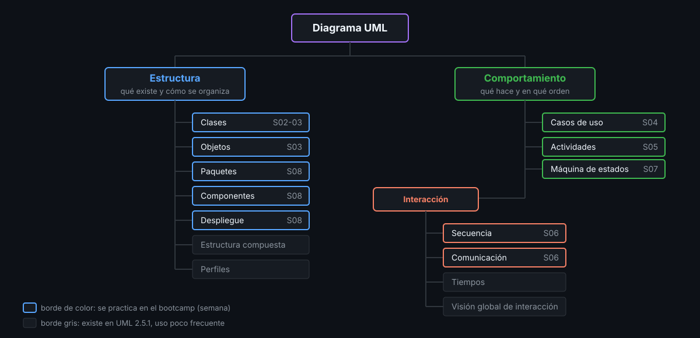

# Taxonomía de UML

UML 2.5.1 define **14 tipos de diagrama** en dos familias. No necesitas los 14: este bootcamp practica 10 y te enseña a reconocer los otros 4.

## Estructura: qué existe

Muestran cosas que existen a la vez y cómo se relacionan, sin tiempo.

| Diagrama | Pregunta que responde |
|---|---|
| Clases | ¿Qué tipos de cosas hay y cómo se relacionan? |
| Objetos | ¿Cómo se ven unas instancias concretas en un momento dado? |
| Paquetes | ¿Cómo se agrupa el modelo y qué depende de qué? |
| Componentes | ¿En qué piezas reemplazables se divide el sistema y qué interfaces exponen? |
| Despliegue | ¿En qué máquinas o contenedores corre cada pieza? |
| Estructura compuesta | ¿Cómo está hecha por dentro una clase compleja? |
| Perfiles | ¿Cómo extiendo UML con estereotipos propios? |

## Comportamiento: qué pasa

Muestran algo que ocurre en el tiempo.

| Diagrama | Pregunta que responde |
|---|---|
| Casos de uso | ¿Qué objetivos consigue cada actor con el sistema? |
| Actividades | ¿Qué pasos sigue un proceso y quién hace cada uno? |
| Máquina de estados | ¿En qué estados puede estar un objeto y qué lo hace cambiar? |
| **Interacción:** secuencia | ¿Qué mensajes se envían los participantes, en qué orden? |
| **Interacción:** comunicación | Lo mismo, pero dibujado sobre los enlaces entre participantes |
| **Interacción:** tiempos | ¿Cuándo cambia cada participante de estado, en un eje de tiempo? |
| **Interacción:** visión global | ¿Cómo se encadenan varias interacciones? |

## Cómo elegir

Empieza por la pregunta, no por el diagrama:

| Si necesitas explicar... | Usa |
|---|---|
| El vocabulario del negocio | Clases (perspectiva conceptual) |
| Qué puede hacer cada tipo de usuario | Casos de uso |
| Un proceso con varias áreas o personas | Actividades con particiones |
| Cómo colaboran objetos para resolver un caso de uso | Secuencia |
| Por qué un pedido no se puede cancelar después de enviado | Máquina de estados |
| Cómo se reparte el sistema en servicios | Componentes |
| Dónde corre cada servicio | Despliegue |

Dos señales de que elegiste mal:

- El diagrama necesita una nota larga para explicar el orden de las cosas: querías un diagrama de comportamiento.
- Un diagrama de secuencia tiene 15 participantes y 60 mensajes: querías varios diagramas, o uno de actividades.

## Notación y herramienta son cosas distintas

UML define la notación. PlantUML es **una** herramienta que la dibuja, con algunas extensiones propias que no son UML (por ejemplo, diagramas de Gantt o de red). Cuando PlantUML permite algo que UML no define, en este bootcamp usas la forma UML.

<!-- nav -->
---

## 🔗 Navegación

| Anterior | Siguiente |
|---|---|
| ← [Teoría — Para qué modelar](01-para-que-modelar.md) | [Teoría — PlantUML en el laboratorio](03-plantuml-en-el-laboratorio.md) → |

[↑ Semana 01](../README.md)
