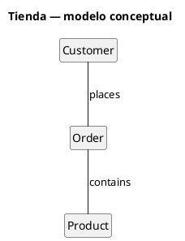

# PlantUML en el laboratorio

## Anatomía de un `.puml`



| Línea | Qué hace |
|---|---|
| `@startuml` / `@enduml` | Abren y cierran el diagrama. Sin ellas no hay diagrama |
| `' texto` | Comentario de una línea; `/' ... '/` para varias |
| `title` | Título que se dibuja encima. En este bootcamp es obligatorio |
| `hide circle` | Quita el círculo con la letra "C" que PlantUML pone a cada clase: no es notación UML |
| `hide empty members` | No dibuja compartimentos vacíos (útil sin atributos) |
| `class X` | Declara una clase |
| `A -- B : verbo` | Asociación entre A y B con nombre |

PlantUML **deduce el tipo de diagrama** de lo que escribes: si hay `class`, es de clases; si hay `A -> B : mensaje` entre participantes, es de secuencia. Mezclar elementos de dos tipos produce errores raros.

## El contenedor `uml`

Todo se ejecuta dentro del contenedor, con PlantUML 1.2026.9 (ver [setup del entorno](../../../docs/setup-entorno.md)):

```bash
docker compose run --rm uml bash      # shell dentro del contenedor, en la raíz del repo
```

Dentro:

| Comando | Qué hace |
|---|---|
| `plantuml -tsvg f.puml` | Genera `f.svg` junto al `.puml` |
| `plantuml -tpng f.puml` | Genera `f.png` |
| `plantuml -tsvg -o salida f.puml` | Escribe en `salida/`, relativo a la carpeta del `.puml` |
| `plantuml -checkonly f.puml` | Solo valida la sintaxis; sale con 0 si está bien y con 200 si no |
| `plantuml -syntax < f.puml` | Imprime el tipo de diagrama y cuántos elementos tiene |

Para un solo comando, sin abrir un shell:

```bash
docker compose run --rm uml plantuml -tsvg bootcamp/.../starter/x.puml
```

El SVG aparece en tu equipo porque el repo está montado en el contenedor. Ábrelo en el navegador.

## Leer un error

Con un `.puml` roto, `plantuml -tsvg` no falla en silencio: escribe un SVG con el error dibujado y por la terminal dice algo como:

```
Error line 3 in file: roto.puml
Some diagram description contains errors
```

La línea indicada es **donde PlantUML se dio cuenta**, no siempre donde está el error: con una llave `{` sin cerrar, señala la línea que abre el bloque, aunque lo que falta esté más abajo. Lee la línea indicada y las siguientes hasta el cierre del bloque.

El código de salida distingue: `0` bien, `200` hay al menos un diagrama con error.

## Por qué no el servidor online

plantuml.com ofrece un servidor que dibuja lo que le envías. Es cómodo, pero el texto del diagrama viaja a un tercero, y el diagrama de un sistema real describe su diseño. En este bootcamp todo se renderiza en local.

## Estilo

El tema por defecto se lee bien en pantalla y en papel. Si un equipo quiere un estilo común, lo pone en un archivo aparte y cada diagrama lo incluye con `!include estilo.iuml`: un solo cambio actualiza todos los diagramas. Lo practicas en el lab 06.

<!-- nav -->
---

## 🔗 Navegación

| Anterior | Siguiente |
|---|---|
| ← [Teoría — Taxonomía de UML](02-taxonomia-uml.md) | [Índice de labs](../2-practicas/README.md) → |

[↑ Semana 01](../README.md)
