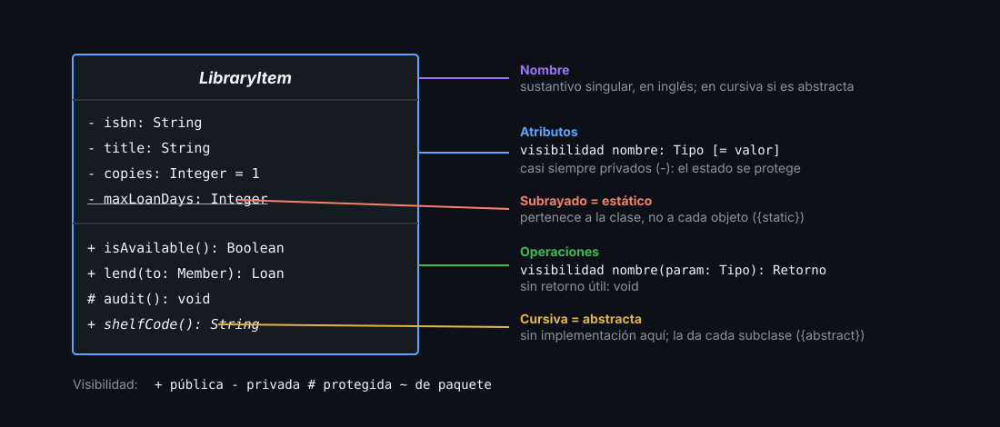
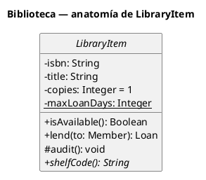

# Anatomía de una clase

Una clase UML es una caja con hasta tres compartimentos: **nombre**, **atributos** y **operaciones**. Cada línea de los dos últimos sigue una sintaxis fija.



## Atributos

```
visibilidad nombre: Tipo [multiplicidad] = valorInicial
```

| Parte | Obligatoria en el bootcamp | Ejemplo |
|---|---|---|
| Visibilidad | Sí | `-` |
| Nombre | Sí, `camelCase` en inglés | `birthDate` |
| Tipo | Sí | `Date` |
| Multiplicidad | Solo si no es exactamente 1 | `phones: String [0..3]` |
| Valor inicial | Solo si importa | `copies: Integer = 1` |

Un `/` delante del nombre marca un atributo **derivado**: se calcula a partir de otros (`/ age: Integer` a partir de `birthDate`).

Tipos: usa tipos simples y neutros (`String`, `Integer`, `Decimal`, `Boolean`, `Date`, `DateTime`, `UUID`) o clases y enums de tu propio modelo. Nada de `varchar(80)` ni `int32`: eso es implementación.

## Operaciones

```
visibilidad nombre(parámetro: Tipo, ...): TipoDeRetorno
```

- Verbos en inglés: `reschedule`, `cancel`, `isAvailable`.
- Cada parámetro con su tipo. Si no devuelve nada útil, `: void`.
- **No** se modelan getters ni setters triviales: tapan las operaciones que importan. Si `name` es privado y se lee desde fuera, se sobrentiende.
- Una operación con nombre de otra clase (`Order.calculateShipping()` cuando el envío es de `Shipment`) es una señal de responsabilidad mal ubicada.

## Visibilidad

| Símbolo | Visibilidad | Úsala para |
|---|---|---|
| `+` | pública | Las operaciones que forman el contrato de la clase |
| `-` | privada | Casi todos los atributos: el estado se protege |
| `#` | protegida | Lo que necesitan las subclases y nadie más |
| `~` | de paquete | Colaboración entre clases del mismo módulo |

Un atributo público casi siempre es un error de diseño: cualquiera puede dejar el objeto en un estado inválido.

## Estático y abstracto

- **Estático** (`{static}` en PlantUML, se dibuja subrayado): pertenece a la clase, no a cada objeto. Ejemplo: el máximo de días de préstamo, igual para todos los libros.
- **Abstracto** (`{abstract}` en PlantUML, se dibuja en cursiva): la operación no tiene implementación aquí. Una clase con una operación abstracta es abstracta.

## En PlantUML



`skinparam classAttributeIconSize 0` hace que PlantUML escriba `+ - # ~` como texto, igual que en UML, en lugar de sus iconos de colores.

## Nivel de detalle

El mismo diagrama de clases cambia según su perspectiva:

| Perspectiva | Qué muestra | Ejemplo |
|---|---|---|
| Conceptual (semana 01) | Solo nombres | `class Book` |
| Especificación (esta semana) | Atributos y operaciones con tipos neutros | `+ lend(to: Member): Loan` |
| Implementación (semana 09) | Tipos y detalles de un lenguaje concreto | `+ lend(Member to): Optional<Loan>` |

Esta semana trabajas en especificación: suficiente detalle para que otra persona entienda qué hace cada clase, sin atarte a un lenguaje.

<!-- nav -->
---

## 🔗 Navegación

| Anterior | Siguiente |
|---|---|
| ← [Semana 02 — Diagrama de clases](../README.md) | [Teoría — Enumeraciones, clases abstractas e interfaces](02-enums-abstractas-e-interfaces.md) → |

[↑ Semana 02](../README.md)
