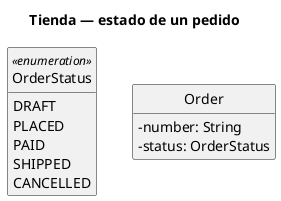
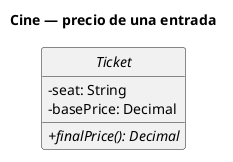
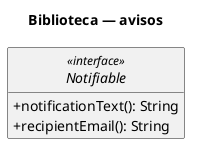

# Enumeraciones, clases abstractas e interfaces

Tres clasificadores que no son "una clase normal" y que aparecen en casi todos los modelos.

## Enumeración

Un tipo con una **lista cerrada de valores**. Se usa como tipo de atributo.

- Valores en `UPPER_SNAKE_CASE`, en inglés.
- Cuándo **no** es un enum: si la lista la mantiene un usuario (las categorías de una tienda), es una clase `Category` con instancias, no un enum.
- Si el valor cambia con reglas (de `PAID` solo se pasa a `SHIPPED` o `CANCELLED`), el enum describe los estados y la semana 07 describe las transiciones con una máquina de estados.

## Clase abstracta

Una clase que **no se instancia directamente**: solo existe a través de sus subclases. Su nombre va en cursiva.

Úsala cuando varias clases comparten estado y comportamiento pero cada una completa una parte de forma distinta (`StudentTicket` y `MemberTicket` calculan `finalPrice()` cada una a su manera). La generalización que las une se dibuja en la semana 03.

## Interfaz

Un **contrato**: un conjunto de operaciones públicas sin estado ni implementación. Varias clases sin parentesco pueden cumplirlo.

| | Clase abstracta | Interfaz |
|---|---|---|
| Tiene atributos | Sí | No |
| Implementa operaciones | Algunas | Ninguna |
| Una clase puede tener... | Una superclase | Varias interfaces |
| Pregunta que responde | ¿Qué **es**? | ¿Qué **sabe hacer**? |

`Loan` y `Reservation` no tienen nada en común salvo que ambas generan avisos: implementan `Notifiable`, no heredan de una clase común.

## Palabras clave explícitas

UML dibuja `«enumeration»` e `«interface»` encima del nombre. PlantUML pone en su lugar un círculo con una letra (E, I), que no es UML; como en el bootcamp lo ocultas con `hide circle`, escribe siempre la palabra clave: `enum X <<enumeration>>` e `interface Y <<interface>>`.

## Estereotipos

Un estereotipo `<<nombre>>` añade significado a un elemento. Además de los dos anteriores, los más comunes en un modelo de dominio son `<<entity>>` (tiene identidad y ciclo de vida) y `<<value>>` (se define solo por sus valores, como `Money`). No los inventes sin explicar en una nota qué significan.

## Errores frecuentes

- Un enum con un único valor o con valores que cambian cada mes.
- Una interfaz con atributos: es una clase abstracta.
- Una clase abstracta sin ninguna subclase posible en el dominio.
- Interfaces con un solo método genérico (`process()`): no dicen nada.

<!-- nav -->
---

## 🔗 Navegación

| Anterior | Siguiente |
|---|---|
| ← [Teoría — Anatomía de una clase](01-anatomia-de-una-clase.md) | [Índice de labs](../2-practicas/README.md) → |

[↑ Semana 02](../README.md)
