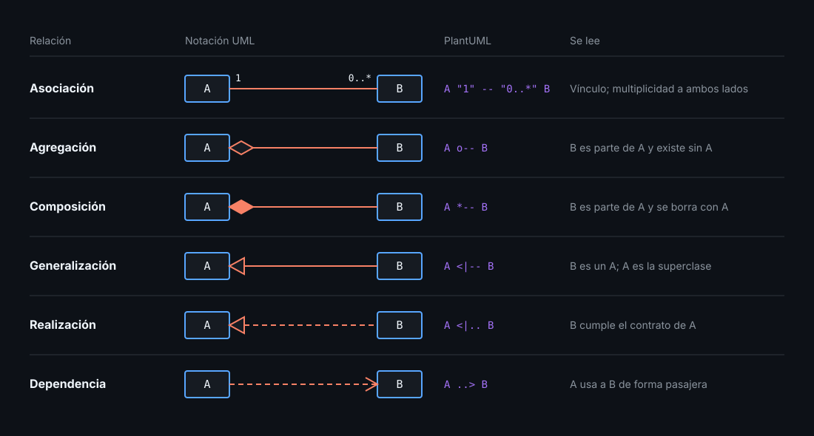
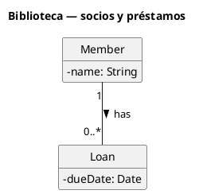
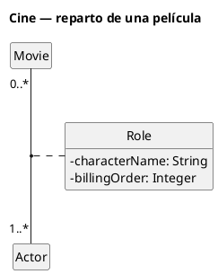

# Asociaciones y multiplicidad

En la semana 02 las clases estaban sueltas. Ahora las unes. UML 2.5.1 tiene seis relaciones entre clases y cada una se distingue por la línea (continua o discontinua) y por lo que lleva en el extremo.

Este archivo cubre las tres primeras: las que unen **objetos** que se conocen entre sí.

## Asociación

Una línea continua dice que los objetos de una clase están vinculados con objetos de la otra. Cada extremo lleva su **multiplicidad**: cuántos objetos de *ese* extremo se vinculan con *uno* del otro.

Se lee en las dos direcciones: un socio tiene de 0 a muchos préstamos; un préstamo es de exactamente 1 socio. El nombre `has` y la punta `>` dicen en qué sentido se lee el nombre; no son una flecha de navegación.

| Multiplicidad | Significa |
|---|---|
| `1` | Exactamente uno |
| `0..1` | Opcional |
| `0..*` (o `*`) | Cero o más |
| `1..*` | Al menos uno |
| `2..4` | Entre dos y cuatro |

En el bootcamp **toda asociación lleva multiplicidad en los dos extremos**. Una línea sin ella no dice nada que se pueda comprobar.

**Roles.** Si el nombre de la clase no basta, el extremo lleva un rol: `Member "borrower 1" -- "0..* loans" Loan`. Úsalos sobre todo cuando dos asociaciones unen las mismas dos clases (`author` y `reviewer` entre `Person` y `Paper`).

## Navegabilidad

Una punta abierta en un extremo dice que desde el otro se puede llegar a él: `Order "1" --> "1..*" OrderLine` significa que el pedido conoce sus líneas y la línea no necesita conocer su pedido. Sin puntas, la navegabilidad no se especifica: en un modelo de dominio es lo normal. Pon flechas solo cuando la dirección es una decisión que importa.

## Agregación y composición

Dos formas de asociación que dicen "es parte de".

```plantuml
@startuml
title Tienda — pedidos y catálogo

hide circle
hide empty members
skinparam classAttributeIconSize 0

class Order
class OrderLine
class Catalog
class Product

' Composición: una línea no existe fuera de su pedido.
Order "1" *-- "1..*" OrderLine
' Agregación: el producto existe sin el catálogo y puede estar en varios.
Catalog "0..*" o-- "0..*" Product
@enduml
```

| | Composición `*--` | Agregación `o--` |
|---|---|---|
| Rombo | Relleno, en el todo | Vacío, en el todo |
| Si se borra el todo | Se borran las partes | Las partes siguen |
| Una parte pertenece a | Un único todo a la vez | Varios todos |
| Multiplicidad del todo | `1` (o `0..1`) | Cualquiera |

**Prueba del borrado:** "si elimino el pedido, ¿tiene sentido que sus líneas sigan existiendo?". Si no, composición. UML 2.5.1 apenas da semántica a la agregación; si dudas, una asociación normal es más honesta que un rombo vacío.

## Clase asociación

Cuando un dato no pertenece a ninguna de las dos clases sino al **vínculo**, la asociación se convierte en clase: el personaje que interpreta un actor no es del actor ni de la película, es de su participación en esa película.

La línea discontinua une la clase con la asociación, no con una de las clases. Hay como mucho un `Role` por cada par película–actor; si un actor puede interpretar dos personajes en la misma película, `Role` pasa a ser una clase normal con dos asociaciones.

## Errores frecuentes

- Multiplicidades al revés: `Member "0..*" -- "1" Loan` dice que cada préstamo tiene muchos socios.
- Composición donde la parte se comparte (un `Product` "parte de" dos pedidos).
- Una asociación además de un atributo con el mismo dato: si `Loan` tiene `- member: Member`, sobra la línea, o sobra el atributo.
- Usar `-->` en todas las líneas por costumbre: la flecha afirma algo.

<!-- nav -->
---

## 🔗 Navegación

| Anterior | Siguiente |
|---|---|
| ← [Semana 03 — Relaciones y diagrama de objetos](../README.md) | [Teoría — Generalización, realización y dependencia](02-generalizacion-realizacion-y-dependencia.md) → |

[↑ Semana 03](../README.md)
