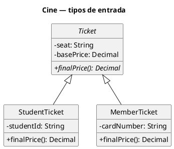
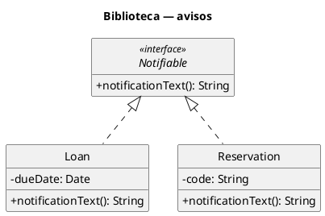
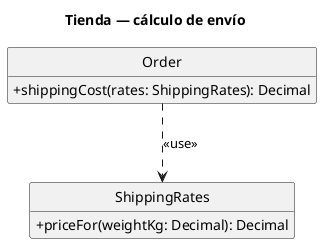

# Generalización, realización y dependencia

Las otras tres relaciones no unen objetos, sino **clasificadores**: dicen qué es cada clase, qué contrato cumple o de qué depende.

## Generalización

Flecha continua con triángulo hueco que apunta a la **superclase**. Se lee "es un": un `StudentTicket` es un `Ticket`.

- La subclase hereda atributos y operaciones: **no los repitas**. Solo se repite una operación cuando la subclase la redefine (`finalPrice()`).
- La generalización no lleva multiplicidad ni nombre.
- Úsala si la frase "X es un Y" es verdad **siempre** y para todos los X. Un `Customer` no "es un" `Address`; un `Manager` puede dejar de serlo, así que suele ser un rol o un atributo, no una subclase de `Employee`.

## Realización

Flecha **discontinua** con triángulo hueco que apunta a la **interfaz**. Se lee "cumple el contrato de".

A diferencia de la herencia, la clase que realiza la interfaz **sí** escribe sus operaciones: la interfaz no implementa nada. Una clase puede realizar varias interfaces.

## Dependencia

Flecha discontinua con punta abierta: una clase **usa** a otra de forma pasajera (como parámetro, variable local o retorno) pero no guarda un vínculo con ella.

Si `Order` guardara las tarifas en un atributo, sería una asociación. Pregunta: "¿el objeto lo recuerda después de la operación?". Sí: asociación. No: dependencia.

## Qué relación elegir

| Pregunta | Relación |
|---|---|
| ¿X es un Y, siempre? | Generalización `<\|--` |
| ¿X cumple el contrato Y? | Realización `<\|..` |
| ¿X es parte de Y y muere con él? | Composición `*--` |
| ¿X guarda un vínculo con Y? | Asociación `--` |
| ¿X solo usa a Y en una operación? | Dependencia `..>` |

## Errores frecuentes

- El triángulo apuntando a la subclase: la flecha siempre va al general.
- Herencia para reutilizar código entre clases que no son "un tipo de" (un `Car` que hereda de `Engine`).
- Realización con línea continua: es una generalización, y una interfaz no se hereda como una clase.
- Dependencias hacia todo lo que una clase toca: dibuja solo las que explican el diseño.

<!-- nav -->
---

## 🔗 Navegación

| Anterior | Siguiente |
|---|---|
| ← [Teoría — Asociaciones y multiplicidad](01-asociaciones-y-multiplicidad.md) | [Teoría — Diagrama de objetos](03-diagrama-de-objetos.md) → |

[↑ Semana 03](../README.md)
