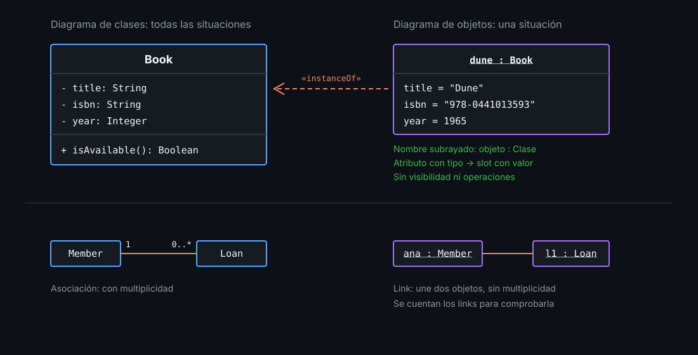
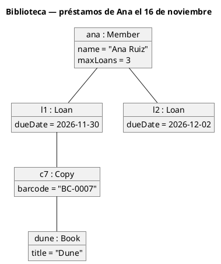

# Diagrama de objetos

Un diagrama de clases describe **todas** las situaciones posibles. Un diagrama de objetos muestra **una**: una fotografía del sistema en un momento concreto, con objetos reales y sus valores.

## Notación

| En el diagrama de clases | En el diagrama de objetos |
|---|---|
| Clase `Member` | Objeto `ana : Member`, subrayado |
| Atributo `- name: String` | Slot `name = "Ana Ruiz"` |
| Asociación con multiplicidad | Link: una línea sin multiplicidad |

- El nombre del objeto es opcional: `: Loan` es "un préstamo cualquiera". El de la clase, en el bootcamp, siempre.
- Solo se escriben los slots que importan para la situación; no hace falta copiar todos los atributos.
- Un link **no lleva multiplicidad**: une exactamente dos objetos. La multiplicidad se ve contando links.
- Los objetos no tienen operaciones ni visibilidad.

En PlantUML, `object "ana : Member" as ana` da el nombre visible y el alias que usan los links. PlantUML no subraya el nombre; UML sí lo pide. Es una diferencia de dibujo que aceptas.

## Para qué sirve

1. **Comprobar las multiplicidades.** Dibuja un caso real y cuenta: si un socio tiene 4 préstamos y tu regla dice `0..3`, o el diagrama de clases está mal o el caso es imposible y debe impedirse.
2. **Explicar un caso difícil.** Un libro con dos autores, un pedido con una devolución parcial: se entiende antes con objetos que con multiplicidades.
3. **Diseñar datos de prueba.** El diagrama de objetos es el estado inicial de un test.

## Coherencia con el diagrama de clases

Cada objeto, slot y link tiene que poder existir según el diagrama de clases:

- La clase del objeto existe en `02-clases.puml`.
- Cada slot corresponde a un atributo de esa clase (o de una superclase), con un valor de su tipo.
- Cada link corresponde a una asociación entre las clases de los dos objetos.
- El número de links de cada objeto respeta la multiplicidad del otro extremo.
- No hay objetos de clases abstractas ni de interfaces: `: Ticket` es imposible si `Ticket` es abstracta; `: StudentTicket` no.

Si al dibujar un objeto necesitas un slot o un link que el diagrama de clases no tiene, el diagrama de objetos acaba de encontrar un hueco en el modelo.

## Errores frecuentes

- Escribir clases dentro del diagrama de objetos (`class`, tipos, visibilidad).
- Poner multiplicidades en los links.
- Instanciar una clase abstracta.
- Valores que no son del tipo del atributo (`status = "terminado"` cuando el tipo es un enum).

<!-- nav -->
---

## 🔗 Navegación

| Anterior | Siguiente |
|---|---|
| ← [Teoría — Generalización, realización y dependencia](02-generalizacion-realizacion-y-dependencia.md) | [Índice de labs](../2-practicas/README.md) → |

[↑ Semana 03](../README.md)
