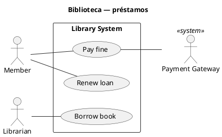
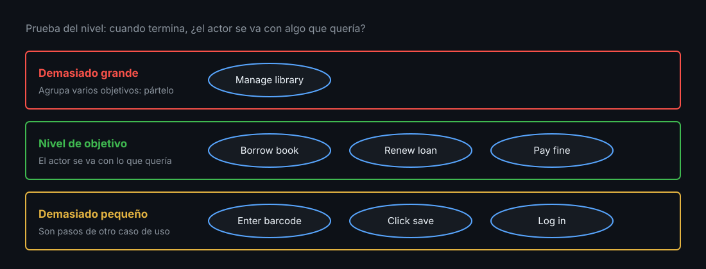

# Actores y casos de uso

Las semanas 01 a 03 describieron **qué hay** en el sistema. Un diagrama de casos de uso describe **para qué sirve**: qué objetivos cumple y para quién.

## Los cuatro elementos

| Elemento | Qué es | En PlantUML |
|---|---|---|
| Actor | Un **rol** externo que interactúa con el sistema | `actor Member` |
| Caso de uso | Un objetivo que el actor consigue con el sistema | `usecase "Borrow book" as CU01` |
| Límite del sistema | Lo que está dentro es responsabilidad del sistema | `rectangle "Library System" { }` |
| Asociación | El actor participa en ese caso de uso | `Member -- CU02` |

- `left to right direction` coloca los actores a los lados y deja el diagrama legible.
- El alias `CU01` une el óvalo con su especificación `CU-01.md` (archivo 03).
- Las asociaciones actor–caso son líneas sin flecha ni multiplicidad.

## Actores

Un actor es un **rol**, no una persona: la misma persona puede ser `Member` por la mañana y `Librarian` por la tarde. Pregunta: "¿quién o qué, **fuera** del sistema, necesita algo de él o le da algo?".

- **Actor principal:** inicia el caso para conseguir su objetivo. Se dibuja a la izquierda.
- **Actor secundario:** el sistema lo necesita para cumplir el caso (una pasarela de pago, un servicio de mensajería). Se dibuja a la derecha.
- Otro sistema es un actor si el tuyo no lo controla. Márcalo con `<<system>>`.
- **No son actores:** la base de datos, el servidor, un módulo propio. Están dentro del límite.
- El reloj puede ser un actor (`actor Clock`) cuando un caso se dispara por tiempo, como "Send overdue reminders" cada noche.

## Casos de uso

Un caso de uso es un **objetivo** del actor, nombrado con verbo en infinitivo + objeto, en inglés: `Borrow book`, `Reserve seat`, `Cancel order`.

**Prueba del nivel:** "cuando termina, ¿el actor se va con algo que quería, y podría irse a casa?". `Borrow book` sí. `Enter barcode` no: es un paso. `Manage library` tampoco: son diez objetivos distintos.

- Un caso de uso no es una pantalla, un botón ni una función de código.
- `Log in` casi nunca es un caso de uso: nadie entra en el sistema porque sí. Es un paso, o un `<<include>>` (archivo 02).
- Los `CRUD` ("Create/Update/Delete X") no son objetivos: busca el verbo del negocio (`Register member`, `Cancel reservation`).

## Cómo encontrarlos

1. Lista los actores de tu `README.md` del modelo.
2. Para cada uno: "¿qué quiere conseguir con el sistema?". Cada respuesta con verbo es un candidato.
3. Pásalos por la prueba del nivel.
4. Busca los secundarios: "¿con quién tiene que hablar el sistema para cumplirlo?".

## Errores frecuentes

- Actores dentro del rectángulo: un actor siempre es externo.
- Flechas entre actor y caso con punta, o entre casos que se ejecutan en secuencia: un diagrama de casos de uso **no muestra orden**. El orden es de la especificación o del diagrama de actividad (semana 05).
- Un actor por cada persona real (`Ana`, `Luis`): los actores son roles.
- Nombres en sustantivo (`Loan management`) en vez de verbo + objeto.

<!-- nav -->
---

## 🔗 Navegación

| Anterior | Siguiente |
|---|---|
| ← [Semana 04 — Casos de uso](../README.md) | [Teoría — Include, extend y generalización](02-include-extend-y-generalizacion.md) → |

[↑ Semana 04](../README.md)
