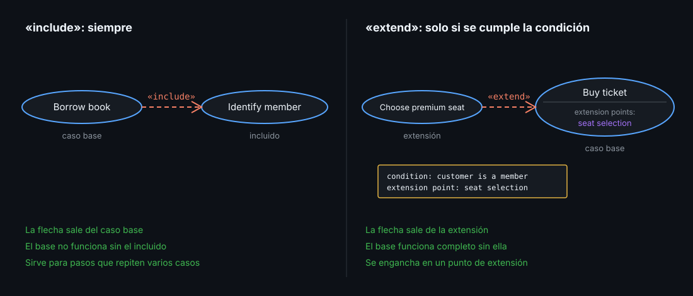
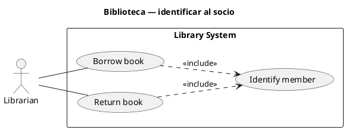
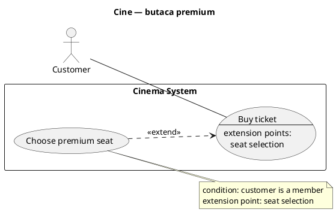
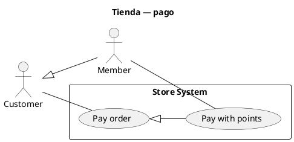

# Include, extend y generalización

Tres relaciones entre casos de uso. Se usan poco: el error más común de esta semana es llenar el diagrama de ellas.

## Include

El caso base **siempre** ejecuta el caso incluido. Sirve para sacar un fragmento que repiten varios casos.

- Flecha discontinua **desde el caso base hacia el incluido**: el base sabe que lo necesita.
- El incluido no suele tener actor propio: no es un objetivo por sí mismo.
- Incluye solo lo que se **repite** en dos casos o más. Un fragmento que solo usa un caso se queda como pasos de su especificación.

## Extend

La extensión **a veces** añade comportamiento al caso base, cuando se cumple una condición en un punto concreto: el **punto de extensión**.

- Flecha discontinua **desde la extensión hacia el caso base**. El base no sabe que existe la extensión: funciona completo sin ella.
- El caso base declara sus puntos de extensión en el óvalo (`--` y `extension points:`).
- La condición y el punto se escriben en una nota unida a la extensión.

| | `<<include>>` | `<<extend>>` |
|---|---|---|
| ¿Se ejecuta siempre? | Sí | Solo si se cumple la condición |
| La flecha sale de | El caso base | La extensión |
| ¿El base funciona sin él? | No | Sí |
| Ejemplo | `Identify member` | `Choose premium seat` |

## Generalización

Igual que entre clases: triángulo hueco hacia lo general.

- **Entre actores:** el actor hijo puede hacer todo lo del padre y algo más. `Member` paga como cualquier `Customer` y además puede pagar con puntos.
- **Entre casos:** el caso hijo es una variante del padre con el mismo objetivo.
- Si las variantes solo difieren en un paso, es mejor un flujo alternativo en la especificación que dos óvalos.

## Errores frecuentes

- `include` para describir pasos en secuencia (`Borrow book` incluye `Scan card`, `Check fines`, `Print receipt`): el diagrama se convierte en un diagrama de flujo.
- La flecha del `extend` apuntando a la extensión.
- `extend` sin condición: si siempre ocurre, es parte del caso base.
- Flecha continua o sin estereotipo: `include` y `extend` son dependencias, siempre `..>`.

<!-- nav -->
---

## 🔗 Navegación

| Anterior | Siguiente |
|---|---|
| ← [Teoría — Actores y casos de uso](01-actores-y-casos-de-uso.md) | [Teoría — Especificación textual](03-especificacion-textual.md) → |

[↑ Semana 04](../README.md)
