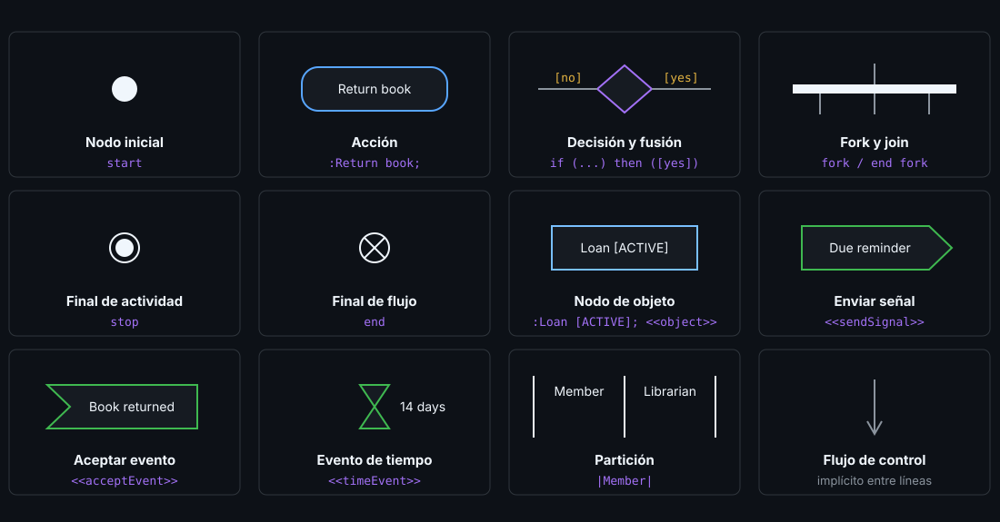
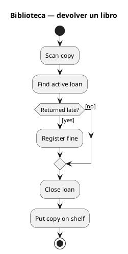
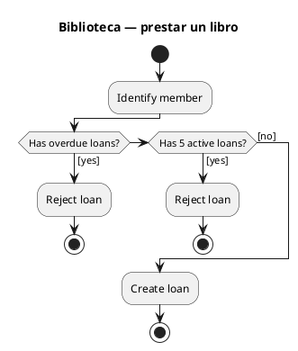
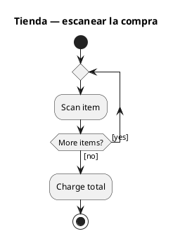

# Acciones, decisiones y finales

Los casos de uso dicen **qué** consigue cada actor; no dicen en qué orden pasan las cosas. El diagrama de actividad modela ese orden: el flujo de trabajo de un proceso, con sus decisiones, sus caminos paralelos y quién hace cada paso.

## Un flujo mínimo

- `start` es el **nodo inicial**: un solo punto de entrada por actividad.
- `:Scan copy;` es una **acción**: un paso que alguien hace. Empieza con `:` y termina con `;`. Se nombra con verbo en infinitivo y objeto (`Scan copy`, no `Copy` ni `Scanning`).
- El **flujo de control** une una línea con la siguiente. PlantUML dibuja las flechas solo.
- `stop` es el **final de actividad**: cuando un flujo llega, termina la actividad entera.

## Decisión y fusión

`if (...) then (...)` dibuja un **nodo de decisión**: un rombo con una entrada y varias salidas. Cada salida lleva una **guarda**, una condición entre corchetes: `[yes]`, `[no]`, `[amount > 50]`. Solo pasa la rama cuya guarda se cumple.

`endif` dibuja la **fusión**: el rombo que vuelve a juntar las ramas. La fusión no espera a nadie: deja seguir al primer flujo que llega.

Reglas de las guardas:

- **Siempre entre corchetes.** `then (yes)` también renderiza, pero UML escribe las guardas como `[yes]`.
- **Exhaustivas:** entre todas cubren todos los casos. Si falta una, el flujo se queda atascado sin salida.
- **Excluyentes:** nunca dos guardas verdaderas a la vez (`[amount > 50]` y `[amount > 20]` lo son con 60).

## Dos finales distintos

| Nodo | PlantUML | Qué termina |
|---|---|---|
| Final de actividad | `stop` | La actividad entera, aunque haya otros flujos en marcha |
| Final de flujo | `end` | Solo el flujo que llega; los demás siguen |

`end` se usa sobre todo en ramas paralelas (ver [Concurrencia y particiones](02-concurrencia-y-particiones.md)). En un flujo sin paralelismo, cada rama que termina el proceso acaba en `stop`.

## Bucles

`repeat ... repeat while` ejecuta el cuerpo al menos una vez. `while (...) is ([yes]) ... endwhile ([no])` puede no ejecutarlo nunca. Los dos se dibujan con decisión y fusión: UML no tiene un nodo de bucle aparte.

## Sintaxis de PlantUML que no usamos

PlantUML tiene dos sintaxis de actividad. Este bootcamp usa la **nueva** (`start`, `:acción;`, `if`). La antigua (`(*) --> "Acción"`) está en desuso: no la mezcles con la nueva.

## Errores frecuentes

- Acciones con nombre de cosa (`Loan`) o de pantalla (`Loan form`) en lugar de verbo y objeto.
- Guardas sin corchetes, que se solapan o que no cubren un caso.
- Una decisión que no vuelve a juntarse y deja ramas colgando sin final.
- Usar el diagrama de actividad para el algoritmo de una operación línea a línea: modela el proceso de negocio, no el código.

<!-- nav -->
---

## 🔗 Navegación

| Anterior | Siguiente |
|---|---|
| ← [Semana 05 — Diagrama de actividades](../README.md) | [Teoría — Concurrencia y particiones](02-concurrencia-y-particiones.md) → |

[↑ Semana 05](../README.md)
