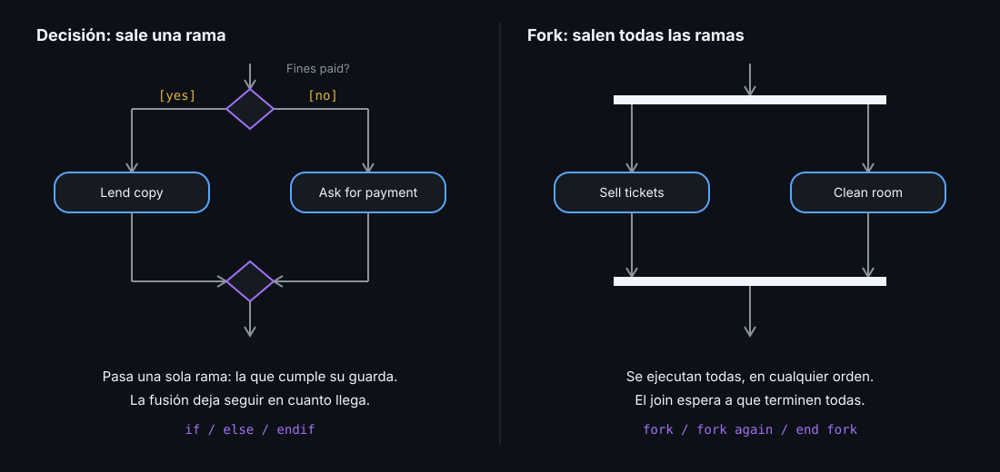
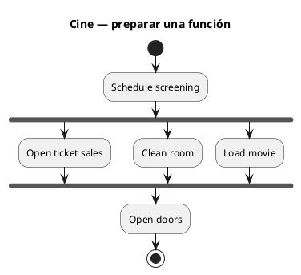
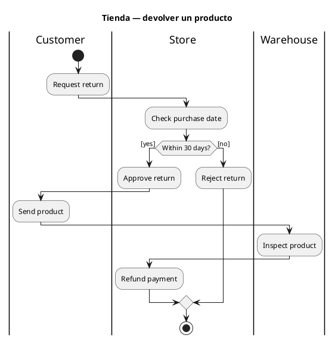

# Concurrencia y particiones

Un proceso real tiene pasos que no dependen unos de otros y pasos que hace gente distinta. El fork modela lo primero; las particiones, lo segundo.

## Fork y join

- `fork` dibuja una barra con una entrada y varias salidas: **todas** las ramas arrancan a la vez.
- `fork again` abre otra rama.
- `end fork` dibuja el **join**: una barra que espera a que **todas** las ramas lleguen.
- "A la vez" no significa en el mismo instante: significa que el orden entre ramas no importa. Si `Clean room` tiene que ir antes que `Load movie`, no son ramas paralelas: van en secuencia.

Una rama puede terminar sin pasar por el join con `end` (final de flujo): esa rama acaba y el resto sigue. Si una rama hace `stop`, termina **toda** la actividad, incluidas las otras ramas.

## Decisión o fork

Pregúntate: **¿pasan todas las ramas o solo una?**

| Situación | Nodo |
|---|---|
| Se cobra con tarjeta **o** con efectivo | Decisión (`if`) |
| Se cobra **y** se envía el ticket por correo | Fork (`fork`) |

Cada apertura se cierra con su pareja: decisión con fusión (`endif`), fork con join (`end fork`). Cerrar un fork con `endif` da error de sintaxis en PlantUML; en UML, juntar ramas paralelas con una fusión deja pasar el flujo varias veces.

## Particiones

Una **partición** (calle o *swimlane*) agrupa las acciones que hace un mismo responsable. En PlantUML, `|Nombre|` cambia de partición: todo lo que viene después cae en ella hasta el siguiente cambio.

- **Una partición por responsable**: un rol (`Customer`, `Librarian`), un área (`Warehouse`) o un sistema externo (`Payment Gateway`). Son los mismos actores del diagrama de casos de uso, más las áreas internas que hacen el trabajo.
- **El sistema que modelas también puede tener su partición** (`Store`, `Library System`) para lo que hace solo, sin una persona.
- **Nunca una pieza técnica**: `Database`, `API` o `Backend` no son responsables de negocio.
- **Las acciones van en la partición de quien las hace**, no de quien las pide: el cliente pide la devolución, pero `Approve return` es de la tienda.
- Declara las particiones en el orden en que quieres verlas de izquierda a derecha: PlantUML las dibuja según aparecen por primera vez.

## Errores frecuentes

- Usar `fork` para alternativas ("tarjeta o efectivo") o `if` para pasos que ocurren todos.
- Cerrar un fork con `endif` o dejarlo sin `end fork`.
- `stop` dentro de una rama paralela cuando solo querías terminar esa rama: es `end`.
- Una partición por cada persona con nombre (`Ana`, `Luis`) en lugar de por rol.
- Particiones de piezas técnicas (`Database`) o con una sola acción que en realidad hace otro responsable.

<!-- nav -->
---

## 🔗 Navegación

| Anterior | Siguiente |
|---|---|
| ← [Teoría — Acciones, decisiones y finales](01-acciones-y-decisiones.md) | [Teoría — Objetos y señales](03-objetos-y-senales.md) → |

[↑ Semana 05](../README.md)
