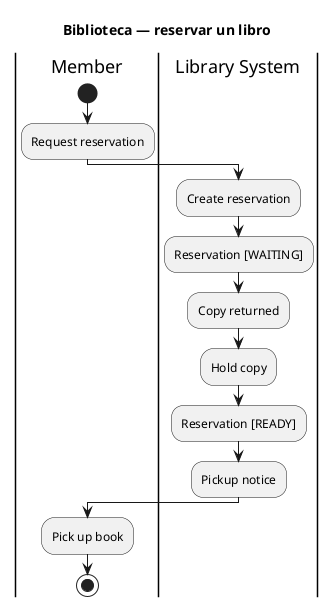
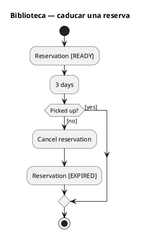

# Objetos y señales

Las acciones cambian cosas y esperan cosas. Los nodos de objeto muestran **qué** produce o consume el proceso; las señales y los eventos, **qué** envía o espera de fuera.

## Nodos de objeto

Un **nodo de objeto** es un rectángulo de esquinas rectas con el nombre de una clase del modelo. Entre corchetes puede llevar el **estado** en que está el objeto en ese punto del flujo.

- En PlantUML se escribe como una acción con el estereotipo `<<object>>`: `:Reservation [READY]; <<object>>`.
- El nombre es **una clase de tu diagrama de clases** (`Reservation`); el estado, **un valor de su enumeración** (`ReservationStatus`). Si no existen, al modelo le falta algo.
- Va entre la acción que lo produce y la que lo consume. Leído en voz alta: `Create reservation` produce una `Reservation` en estado `WAITING`.
- Úsalos donde el objeto cambia de estado o pasa de un responsable a otro. No hace falta uno después de cada acción.

En UML estricto, los nodos de objeto se conectan con **flujos de objeto** y las acciones tienen **pines** de entrada y salida. PlantUML no dibuja pines: el nodo de objeto en medio del flujo es la notación abreviada que UML 2.5.1 también admite.

## Señales y eventos

| Nodo | PlantUML | Forma | Qué hace |
|---|---|---|---|
| Enviar señal | `:Pickup notice; <<sendSignal>>` | Pentágono hacia la derecha | Envía un mensaje y sigue sin esperar respuesta |
| Aceptar evento | `:Copy returned; <<acceptEvent>>` | Rectángulo con muesca | Espera hasta que llega algo de fuera |
| Evento de tiempo | `:3 days; <<timeEvent>>` | Reloj de arena | Espera hasta que pasa un tiempo |

- **Enviar señal** es asíncrono: el aviso sale y el proceso continúa. Si el proceso tiene que esperar la respuesta, después viene un **aceptar evento**.
- **Aceptar evento** detiene el flujo hasta que el evento llega: un pago confirmado, un libro devuelto, la respuesta de un proveedor.
- **Evento de tiempo** detiene el flujo hasta que pasa un plazo o llega una hora: `3 days`, `Every day at 8:00`.

## Trazabilidad

El diagrama de actividad conecta las vistas que ya tienes:

- **Con los casos de uso:** la actividad recorre uno o varios casos (cítalos: `Identify member (CU03)`). Sus particiones son los actores del diagrama de casos de uso.
- **Con las clases:** cada nodo de objeto es una clase de `02-clases.puml` y cada estado, un valor de su enumeración.
- **Con las especificaciones:** las decisiones son los flujos alternativos de `CU-NN.md`.

## Errores frecuentes

- `:Reservation]` y otras terminaciones antiguas (`>`, `<`, `|`): PlantUML 1.2026.9 da `Syntax Error?`. Usa `;` y el estereotipo.
- Nodos de objeto con nombres que no son clases del modelo (`Data`, `Info`, `Form`).
- `sendSignal` seguido de una acción que necesita la respuesta, sin un `acceptEvent` que la espere.
- Un evento de tiempo sin plazo (`:Wait; <<timeEvent>>`): di cuánto.

<!-- nav -->
---

## 🔗 Navegación

| Anterior | Siguiente |
|---|---|
| ← [Teoría — Concurrencia y particiones](02-concurrencia-y-particiones.md) | [Índice de labs](../2-practicas/README.md) → |

[↑ Semana 05](../README.md)
