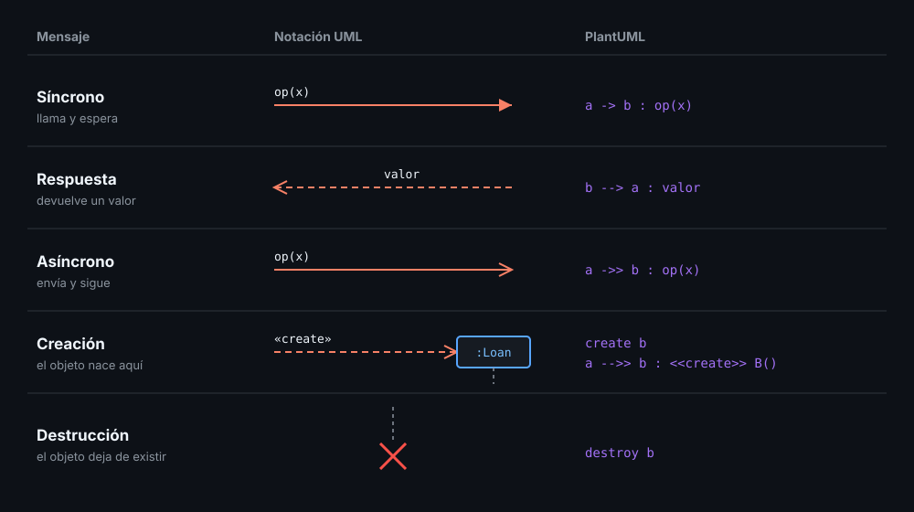
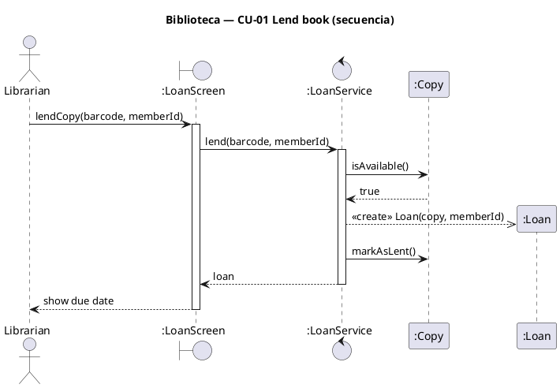

# Lifelines y mensajes

El diagrama de actividad dice **qué pasos** tiene un proceso. El de secuencia dice **qué objetos colaboran** para cumplir un escenario de un caso de uso y **en qué orden se envían mensajes**. Es donde descubres las operaciones que les faltan a tus clases.

## Un escenario, un diagrama

## Lifelines

Una **lifeline** es un participante de la interacción: una caja arriba y una línea discontinua hacia abajo, que es el tiempo.

| Lifeline | PlantUML | Qué representa |
|---|---|---|
| Actor | `actor Librarian` | Quien inicia el caso de uso, el mismo de `04-casos-de-uso.puml` |
| Boundary | `boundary ":LoanScreen" as ui` | Lo que separa al actor del sistema: pantalla, API, pasarela |
| Control | `control ":LoanService" as svc` | Quien coordina el escenario |
| Objeto del dominio | `participant ":Copy" as copy` | Una instancia de una clase de `02-clases.puml` |

- El nombre de un objeto es `nombre:Clase`. Si el nombre no importa, queda `:Copy` (objeto anónimo). Sin los dos puntos, `Copy` sería otra cosa: la clase, no una instancia.
- `as copy` es el alias corto que usas en los mensajes.
- **Boundary y control no hace falta que estén en el diagrama de clases del dominio**; los objetos `participant` sí. Si un mensaje llega a `:Copy`, la clase `Copy` existe.

## Mensajes

| Mensaje | PlantUML | Cuándo |
|---|---|---|
| Síncrono | `a -> b : op(x)` | `a` llama y **espera** la respuesta |
| Respuesta | `b --> a : valor` | Lo que devuelve la llamada síncrona |
| Asíncrono | `a ->> b : op(x)` | `a` envía y **sigue** sin esperar: avisos, colas, correos |
| Creación | `create b` y `a -->> b : <<create>> B(x)` | El objeto nace durante la interacción: su caja baja hasta ese punto |
| Destrucción | `destroy b` | El objeto deja de existir: una X cierra su lifeline |
| A sí mismo | `a -> a : op()` | Un cálculo interno que quieres hacer visible |

- **Un mensaje síncrono es una operación** de la clase que lo recibe: nombre en *lowerCamelCase*, con paréntesis y argumentos. Si `:Copy` recibe `isAvailable()`, `Copy` tiene `+ isAvailable(): Boolean`. Si no la tiene, añádela a `02-clases.puml`.
- **Una respuesta es un valor**, no una operación: `true`, `loan`, `slots`. Sin paréntesis.
- **Las respuestas son opcionales.** Dibújalas solo cuando el valor devuelto se usa después.
- **Activación** (`activate` / `deactivate`): la barra fina sobre la lifeline marca el tiempo en que el objeto está ocupado. Úsala en los objetos que coordinan, no en todos.

## Errores frecuentes

- Mensajes con nombre de pantalla o de paso (`Loan screen`, `Validation`): un mensaje es una llamada, no un rótulo.
- Una lifeline por clase en vez de por objeto: dos ejemplares distintos (`c1:Copy`, `c2:Copy`) son dos lifelines.
- Respuestas con flecha síncrona (`copy -> svc : true`) o llamadas con flecha de respuesta (`svc --> copy : markAsLent()`).
- Errores de tipeo en el alias: `svc -> cpy : isAvailable()` no da error; PlantUML crea una lifeline nueva `cpy`.
- Bajar al detalle del código (getters, bucles de un `for`). La secuencia muestra colaboración entre objetos, no la implementación.

<!-- nav -->
---

## 🔗 Navegación

| Anterior | Siguiente |
|---|---|
| ← [Semana 06 — Secuencia y comunicación](../README.md) | [Teoría — Fragmentos combinados](02-fragmentos.md) → |

[↑ Semana 06](../README.md)
