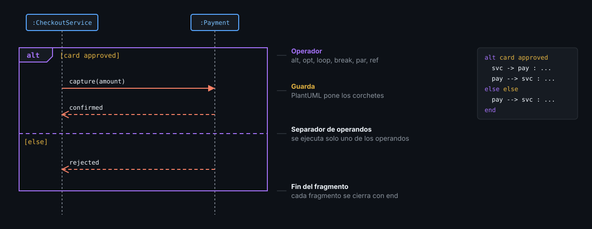
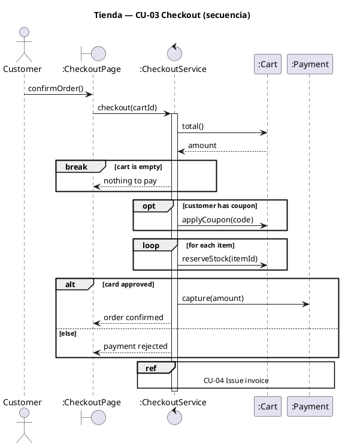

# Fragmentos combinados

Un diagrama de secuencia sin fragmentos solo cuenta el camino feliz. Los **fragmentos combinados** añaden las alternativas, las partes opcionales y las repeticiones de la especificación del caso de uso, sin dibujar un diagrama por cada flujo alternativo.

## Ejemplo

## Operadores

| Operador | Qué significa | Equivale en la especificación a |
|---|---|---|
| `alt` / `else` | Uno y solo uno de los operandos, el primero cuya guarda se cumple | Flujo principal frente a flujo alternativo |
| `opt` | El operando ocurre o no ocurre | Un paso que solo pasa a veces |
| `loop` | El operando se repite mientras la guarda se cumpla | "Para cada producto…" |
| `break` | Si la guarda se cumple, se hace el operando y **termina** el fragmento que lo contiene | "…y el caso de uso termina" |
| `par` / `else` | Los operandos ocurren en paralelo, sin orden entre ellos | Pasos independientes |
| `ref` | Referencia a otra interacción dibujada aparte | Un `<<include>>` del diagrama de casos de uso |

Cada fragmento se cierra con `end`. `ref over a, b : texto` no lleva `end`: es una sola línea.

## Guardas: sin corchetes en PlantUML

Una **guarda** es la condición, en UML entre corchetes (`[card approved]`). PlantUML **pone los corchetes solo**: escribe `alt card approved`, no `alt [card approved]`. Si los escribes tú, PlantUML los lee como un enlace web y dibuja la guarda subrayada en azul.

- Todo `alt`, `opt`, `loop` y `break` lleva guarda, y cada `else` de un `alt` también. Un `alt` sin guarda no dice cuándo se elige. Los operandos de `par` no llevan guarda: su `else` va solo.
- El último operando de un `alt` suele ser `else else`: el primer `else` es la palabra de PlantUML; el segundo, la guarda `[else]` de UML (ninguna de las anteriores).
- Las guardas de un `alt` son **excluyentes**: si dos se cumplen a la vez, el diagrama no dice qué pasa.

## Fragmento o diagrama nuevo

- **Un fragmento** cuando la alternativa es corta (2 o 3 mensajes) y vuelve al flujo.
- **Un `ref`** cuando la parte es otro caso de uso (`<<include>>`) o se repite en varios diagramas.
- **Otro diagrama** cuando el flujo alternativo es largo: un `alt` de 30 líneas no lo lee nadie.

## Errores frecuentes

- `alt` con un solo operando: eso es `opt`.
- Un `loop` o un `alt` sin `end`: PlantUML lo renderiza igual y mete en el fragmento todos los mensajes hasta el final del diagrama.
- Un `end` de más o un `else` fuera de un `alt`: `Cannot create group`.
- Guardas con nombres de variables de código (`if x != null`): la guarda se escribe con palabras del dominio.
- Usar `loop` para repetir algo una vez por cada objeto ya dibujado: si dibujas cada iteración, no es un `loop`.

<!-- nav -->
---

## 🔗 Navegación

| Anterior | Siguiente |
|---|---|
| ← [Teoría — Lifelines y mensajes](01-lifelines-y-mensajes.md) | [Teoría — Diagrama de comunicación](03-comunicacion.md) → |

[↑ Semana 06](../README.md)
