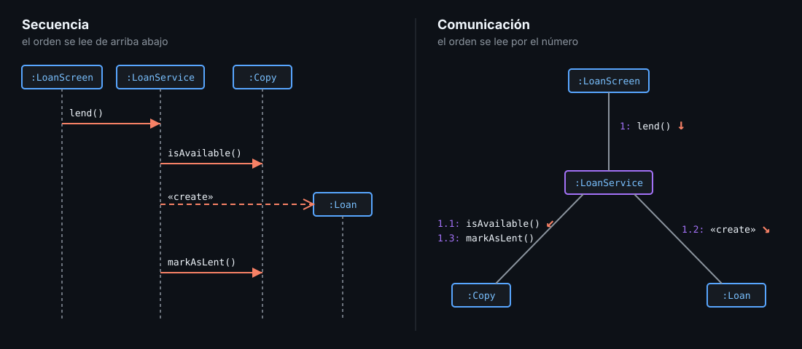
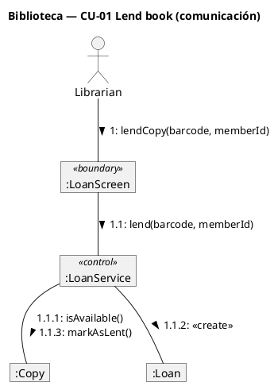

# Diagrama de comunicación

Un diagrama de comunicación muestra **la misma interacción** que uno de secuencia, pero dibuja los objetos libremente y pone los mensajes sobre los **enlaces** entre ellos. El orden ya no sale de la posición vertical: sale de un **número de secuencia** delante de cada mensaje.

## Ejemplo

El préstamo de [lifelines y mensajes](01-lifelines-y-mensajes.md) como comunicación:

- PlantUML no tiene un tipo de diagrama de comunicación: se dibuja como **diagrama de objetos** (`object`). `plantuml -syntax` dice `CLASS`.
- `allowmixing` deja poner un `actor` junto a objetos. Sin él: `Use 'allowmixing' if you want to mix classes and other UML elements`.
- Los **enlaces** son líneas sin flecha (`--`): dicen que los dos objetos se conocen.
- La **dirección del mensaje** va al final de la etiqueta: `>` apunta del primer objeto del enlace al segundo, `<` al revés. Escribe el enlace empezando por quien envía y usa siempre `>`.
- Las respuestas no se dibujan: quedan implícitas en cada llamada.

## Numeración decimal

| Número | Qué significa |
|---|---|
| `1`, `2` | Mensajes que envía el actor, en orden |
| `1.1`, `1.2` | Mensajes que se envían **mientras se atiende** `1`, en orden |
| `1.1.1` | Mensaje enviado mientras se atiende `1.1` |

El número dice quién está esperando a quién: `1.1.2` ocurre dentro de `1.1`, que ocurre dentro de `1`. Es la misma información que dan las barras de activación en secuencia.

- **Un enlace por pareja de objetos.** Si dos objetos se hablan varias veces, apila los mensajes en la misma etiqueta con `\n` (`"1.1.1: isAvailable()\n1.1.3: markAsLent() >"`).
- Una guarda va entre corchetes después del número: `"2 [card approved]: capture(amount) >"`. Una repetición, con asterisco: `"1.2 *[for each item]: reserveStock(itemId) >"`.

## Secuencia o comunicación

| Pregunta | Diagrama |
|---|---|
| ¿En qué orden pasan las cosas y qué alternativas hay? | Secuencia |
| ¿Qué objetos necesitan conocerse? ¿Hay uno que habla con todos? | Comunicación |

Los dos dicen lo mismo; cada uno hace fácil de ver una cosa distinta. El de comunicación delata al **objeto dios**: si todos los enlaces salen de uno, ese objeto hace demasiado. Y cada enlace debe tener detrás una asociación (o un parámetro) en el diagrama de clases: si `:Loan` habla con `:Copy`, alguien tiene que conocer a quién.

## Errores frecuentes

- Mensajes sin número o con números repetidos.
- Numeración plana (`1, 2, 3, 4…`) cuando hay llamadas anidadas: se pierde quién espera a quién.
- Dos enlaces entre el mismo par de objetos.
- Flechas `-->` entre objetos en vez de enlaces `--`: en un diagrama de objetos, una flecha es otra relación, no un mensaje.
- Un diagrama de comunicación que no corresponde a ninguna secuencia: deben contar la misma interacción.

<!-- nav -->
---

## 🔗 Navegación

| Anterior | Siguiente |
|---|---|
| ← [Teoría — Fragmentos combinados](02-fragmentos.md) | [Índice de labs](../2-practicas/README.md) → |

[↑ Semana 06](../README.md)
