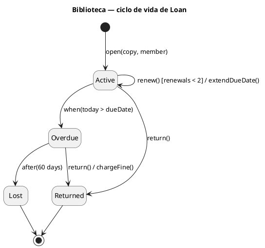
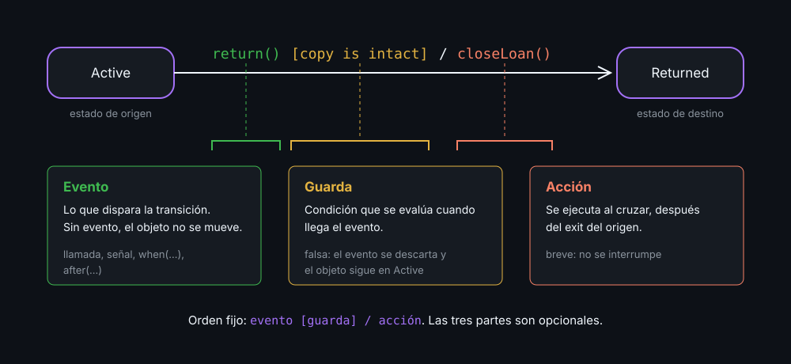
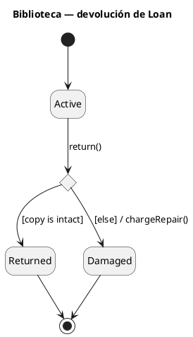

# Estados y transiciones

La secuencia cuenta cómo colaboran varios objetos durante un caso de uso. Una **máquina de estados** cuenta la vida entera de **un solo objeto**, a lo largo de muchos casos de uso: qué operaciones tienen sentido en cada momento y qué pasa cuando llega una que no lo tiene.

Se dibuja solo para clases con **ciclo de vida**, que pasan por etapas y se comportan distinto en cada una: un préstamo, un pedido, una cita.

## Ejemplo



## Qué hay en el diagrama

- **Estado** (`Active`): una situación en la que el objeto espera algo y responde a ciertos eventos. Se nombra con un adjetivo o un participio en inglés. `hide empty description` quita la franja vacía que PlantUML dibuja bajo cada nombre.
- **Estado inicial** (`[*] -->`): un pseudoestado, no un estado. El objeto nunca está en él; solo marca por dónde empieza su vida.
- **Estado final** (`--> [*]`): la vida del objeto termina. Puede haber varias transiciones que lleguen a él.
- **Transición** (`-->`): el paso de un estado a otro. Su etiqueta tiene tres partes, todas opcionales y siempre en este orden:



```
evento(parámetros) [guarda] / acción
```

- El **evento** dispara la transición. Sin evento, no pasa nada.
- La **guarda** es una condición booleana que se evalúa cuando llega el evento. Si es falsa, el evento se descarta y el objeto sigue en su estado. Va entre corchetes, y aquí sí los escribes tú (en la secuencia los ponía PlantUML).
- La **acción** se ejecuta al cruzar, breve y sin interrumpirse.

Si escribes la guarda antes del evento (`[renewals < 2] renew()`), PlantUML lo dibuja igual, pero ya no es notación UML: el lector no sabe qué dispara la transición.

## Cuatro tipos de evento

| Evento | Forma | Qué significa | Ejemplo |
|---|---|---|---|
| De llamada | `op(args)` | Alguien invoca una operación de la clase | `return()` |
| De señal | `nombreSeñal` | Llega un mensaje asíncrono | `paymentReceived` |
| De cambio | `when(condición)` | Una condición pasa a ser verdadera | `when(today > dueDate)` |
| De tiempo | `after(duración)` | Pasa un tiempo desde que se entró al estado | `after(60 days)` |

Los eventos de llamada te devuelven al diagrama de clases: si `return()` dispara una transición de `Loan`, `Loan` necesita la operación `+ return(): void`. Es la misma trazabilidad de la semana 06: el diagrama de comportamiento descubre operaciones que faltaban.

## Estados y atributos

El estado de un objeto suele guardarse en un atributo de tipo enumeración. Si `Loan` tiene `- status: LoanStatus` y `LoanStatus` tiene `ACTIVE`, `OVERDUE`, `RETURNED` y `LOST`, los estados de primer nivel de la máquina se llaman igual: `Active`, `Overdue`, `Returned`, `Lost`. Si un estado no tiene literal, o un literal no tiene estado, uno de los dos diagramas está mal.

## Decisiones dentro de una transición

Cuando un evento lleva a estados distintos según una condición, usa un pseudoestado **choice** (rombo) y pon las guardas en sus salidas. Una salida lleva `[else]` para que nunca falte camino:



## Errores típicos

- Nombrar un estado con un verbo (`Return`): eso es un evento, no una situación.
- Dos transiciones con el mismo evento desde el mismo estado y sin guardas que las separen: la máquina no sabe cuál tomar.
- Un estado sin transiciones de salida que no es el final: el objeto queda atrapado.
- Un estado al que no llega ninguna transición: nunca se alcanza.

<!-- nav -->
---

## 🔗 Navegación

| Anterior | Siguiente |
|---|---|
| ← [Semana 07 — Máquinas de estados](../README.md) | [Teoría — Actividades internas](02-actividades-internas.md) → |

[↑ Semana 07](../README.md)
