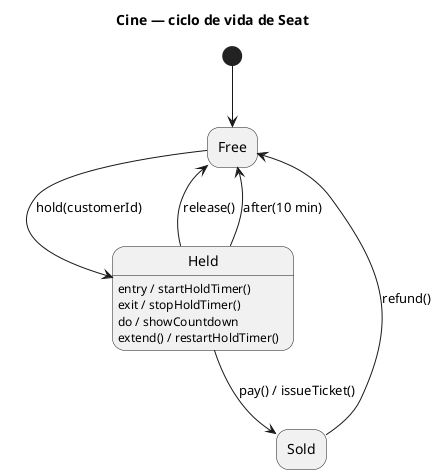
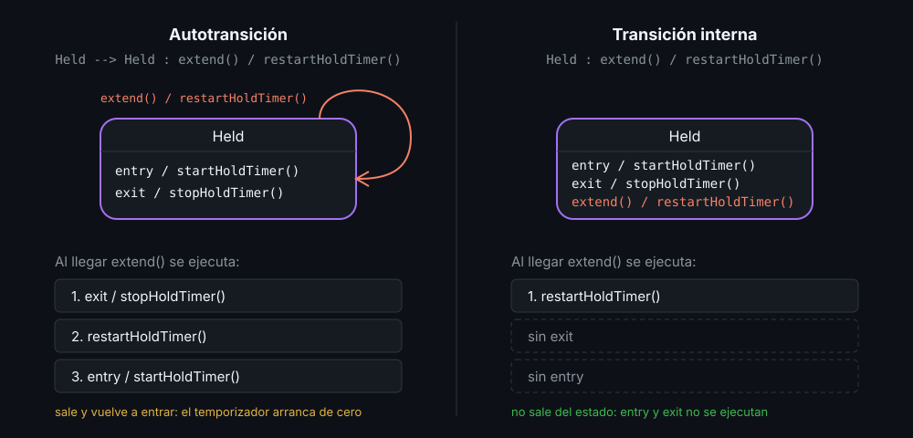

# Actividades internas

Hay comportamiento que no depende de por dónde entra o sale el objeto, sino de estar en un estado. Si una butaca bloqueada siempre arranca un temporizador al bloquearse, escribirlo en cada transición que llega a `Held` repite la misma acción y deja fuera la próxima transición que alguien añada. Lo escribes una sola vez dentro del estado.

## Ejemplo

## Las cuatro líneas dentro de un estado

| Línea | Cuándo se ejecuta | Ejemplo |
|---|---|---|
| `entry / acción` | Cada vez que el objeto entra al estado, venga de donde venga | `entry / startHoldTimer()` |
| `exit / acción` | Cada vez que sale, por la transición que sea | `exit / stopHoldTimer()` |
| `do / actividad` | Mientras está en el estado; se interrumpe si sale | `do / showCountdown` |
| `evento / acción` | Transición interna: llega el evento, se ejecuta la acción y **no sale** del estado | `extend() / restartHoldTimer()` |

`entry` y `exit` son acciones breves que no se interrumpen. `do` es una actividad que dura (mostrar una cuenta atrás, reproducir un aviso) y por eso se escribe sin paréntesis: no es una llamada puntual. En PlantUML, las cuatro se escriben como líneas `Estado : texto`, y se dibujan dentro de la caja del estado.

## Transición interna o autotransición

Una transición interna y una autotransición (`Held --> Held : extend()`) parecen lo mismo y no lo son:

- La **autotransición** sale del estado y vuelve a entrar. Se ejecuta `exit`, después la acción y después `entry`: el temporizador se detiene y arranca de nuevo.
- La **transición interna** no sale. Solo se ejecuta su acción: `entry` y `exit` no se tocan.

Elige según lo que deba pasar con `entry` y `exit`. Si al ampliar el bloqueo hay que reiniciar todo lo que hace `entry`, es autotransición; si solo cambia un dato, es interna.

## Orden de ejecución al cruzar una transición

Cuando llega `pay()` a una butaca en `Held`:

1. Se evalúa la guarda, si la hay. Si es falsa, no pasa nada más.
2. Se interrumpe la actividad `do` de `Held`.
3. Se ejecuta `exit / stopHoldTimer()`.
4. Se ejecuta la acción de la transición: `issueTicket()`.
5. Se ejecuta el `entry` de `Sold`, si lo tiene.

Este orden explica por qué `stopHoldTimer()` va en `exit` y no en la acción de `pay()`: también debe ejecutarse cuando salen `release()`, `after(10 min)` o cualquier transición que se añada mañana.

## Eventos de tiempo y de cambio

`after(10 min)` cuenta desde que el objeto entró al estado. Si sale y vuelve a entrar, la cuenta empieza otra vez. `when(condición)` se dispara en el instante en que la condición pasa de falsa a verdadera, no mientras sigue siendo verdadera.

## Errores típicos

- Poner la misma acción en todas las transiciones que llegan a un estado, en vez de usar `entry`.
- Escribir `do / startHoldTimer()` para una acción puntual: arrancar un temporizador es `entry`.
- Usar una autotransición cuando no quieres que se repitan `exit` y `entry`.
- Escribir `entry startHoldTimer()` sin la barra: PlantUML lo dibuja como texto y deja de ser una actividad interna.

<!-- nav -->
---

## 🔗 Navegación

| Anterior | Siguiente |
|---|---|
| ← [Teoría — Estados y transiciones](01-estados-y-transiciones.md) | [Teoría — Estados compuestos e historia](03-compuestos-e-historia.md) → |

[↑ Semana 07](../README.md)
