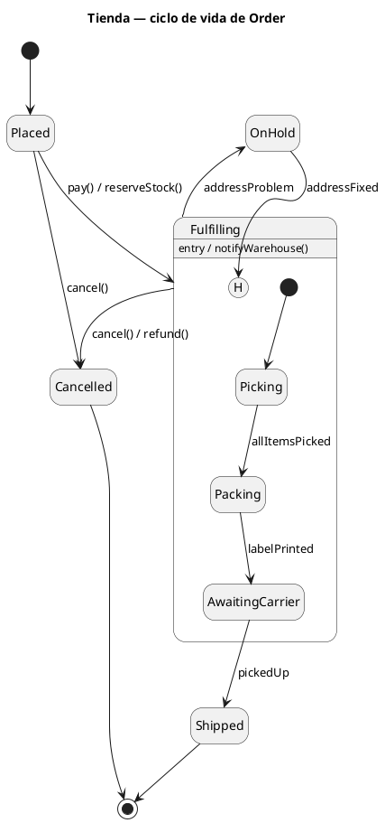
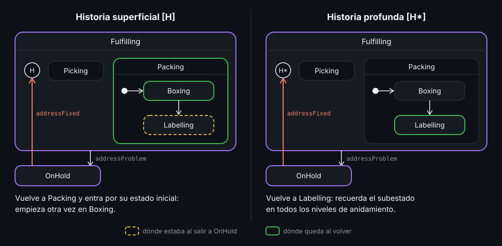
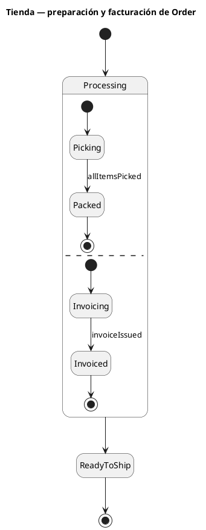

# Estados compuestos e historia

Cuando varios estados comparten las mismas transiciones de salida, la máquina se llena de flechas repetidas. Si un pedido puede cancelarse mientras se prepara, se empaqueta o espera al transportista, son tres flechas `cancel()` iguales. Un **estado compuesto** agrupa esos estados y dibuja la flecha una sola vez.

## Ejemplo

## Qué hay en el diagrama

- **Estado compuesto** (`state Fulfilling { ... }`): un estado que contiene una máquina propia. Mientras el pedido está en `Picking`, también está en `Fulfilling`.
- **Subestados** (`Picking`, `Packing`, `AwaitingCarrier`): los estados de la máquina interna. Llevan su propio estado inicial: al entrar en `Fulfilling` por el borde, el pedido empieza en `Picking`.
- **Transición desde el borde** (`Fulfilling --> Cancelled : cancel()`): vale para todos los subestados. Una flecha sustituye a tres.
- **Transición desde un subestado** (`AwaitingCarrier --> Shipped`): solo sale desde ahí. Un pedido en `Picking` no puede pasar a `Shipped`.
- `entry` y `exit` del compuesto se ejecutan al entrar en él o al salir de él, no al cambiar entre subestados.

En PlantUML, las actividades internas del compuesto (`Fulfilling : entry / ...`) se escriben fuera de las llaves. Si escribes un `}` de más, falla con `No inner state defined`; si te falta uno, renderiza, pero los estados siguientes quedan dentro del compuesto.

## Historia

Cuando el pedido sale a `OnHold` por un problema con la dirección y vuelve, ¿empieza otra vez en `Picking`? Sin historia, sí: entrar por el borde lleva al estado inicial. Con historia, vuelve al subestado en el que estaba.

| Pseudoestado | PlantUML | Recuerda |
|---|---|---|
| Historia superficial | `Fulfilling[H]` | El subestado directo en el que estaba (`Packing`) |
| Historia profunda | `Fulfilling[H*]` | También los subestados de los subestados, a cualquier profundidad |

La historia solo tiene sentido como destino de una transición que vuelve al compuesto desde fuera. Si el compuesto no tiene subestados compuestos, `[H]` y `[H*]` hacen lo mismo: usa `[H]`.

## Regiones concurrentes

A veces un objeto está en dos estados a la vez, independientes entre sí. Un pedido pagado se prepara en el almacén y, en paralelo, se factura. Dentro del compuesto, `--` separa las **regiones**:

Cada región tiene su estado inicial y su final. El compuesto termina cuando **todas** sus regiones llegan a su final, y entonces se dispara la transición sin evento (`Processing --> ReadyToShip`). Úsalas solo si las dos partes cambian de verdad por separado. Si una espera a la otra, es una sola secuencia de estados.

## Errores típicos

- Dibujar la misma transición desde cada subestado en lugar de dibujarla una vez desde el borde.
- Olvidar el estado inicial dentro del compuesto: una transición que llega al borde no sabe en qué subestado empezar.
- Usar historia cuando no hay ningún camino de vuelta al compuesto.
- Partir en regiones algo que ocurre en orden: eso es una cadena de estados, no concurrencia.

<!-- nav -->
---

## 🔗 Navegación

| Anterior | Siguiente |
|---|---|
| ← [Teoría — Actividades internas](02-actividades-internas.md) | [Índice de labs](../2-practicas/README.md) → |

[↑ Semana 07](../README.md)
