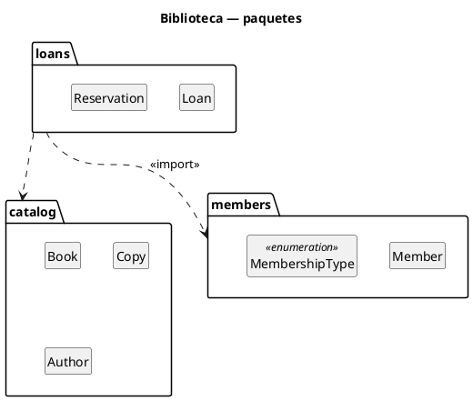

# Paquetes y dependencias

Con quince clases, el diagrama de clases ya no cabe en una pantalla ni en una cabeza. Un **paquete** agrupa clases que cambian juntas y les da un nombre. El diagrama de paquetes enseña esos grupos y quién depende de quién: es lo primero que mira alguien que llega nuevo al proyecto.

## Ejemplo

## Qué hay en el diagrama

- **Paquete** (`package catalog { ... }`): una carpeta con pestaña. Cada clase pertenece a un solo paquete. El nombre va en minúsculas, como un espacio de nombres de código.
- **Clases dentro** (`class Book`): solo el nombre. Los atributos y las operaciones ya están en `02-clases.puml`. Aquí importa a qué grupo pertenece cada clase, no qué tiene.
- **Dependencia** (`loans ..> catalog`): flecha discontinua con punta abierta. Se lee "algo de `loans` usa algo de `catalog`": si cambia `Copy`, puede romperse `Loan`, nunca al revés.
- **`<<import>>`**: los elementos de `members` se pueden nombrar desde `loans` sin cualificar (`Member` en lugar de `members::Member`). `<<access>>` es la misma importación, pero privada: lo importado no se vuelve a exportar. Una dependencia sin estereotipo basta para la mayoría de modelos.

## De dónde sale la dirección

No la eliges en este diagrama: ya la decidiste en el de clases. Cada asociación navegable, cada parámetro y cada tipo de retorno que cruza de un paquete a otro es una dependencia entre los dos paquetes. Si `Loan` tiene un atributo `copy: Copy`, `loans` depende de `catalog`.

Para comprobarlo, recorre las relaciones de `02-clases.puml` que unen clases de paquetes distintos y anota la flecha. Si una asociación no tiene navegabilidad, decide quién necesita conocer a quién y escríbelo en un comentario.

## Sin ciclos

Si `loans ..> catalog` y además `catalog ..> loans`, ningún paquete se puede entender, probar ni cambiar sin el otro: en la práctica son uno solo. Las dependencias tienen que formar capas. Arriba van los que usan; abajo, los que se usan.

Cuando aparece un ciclo, tienes tres salidas:

1. **Mover la clase** que lo provoca al otro paquete, si en realidad pertenecía allí.
2. **Invertir la dependencia** con una interfaz: el paquete de abajo define `Notifiable` y el de arriba la implementa.
3. **Quitar navegabilidad**: muchas veces una de las dos direcciones de la asociación no la usa nadie.

## Cómo agrupar

- Agrupa por lo que cambia junto, no por tipo de clase. Un paquete `enums` o `entities` no dice nada del dominio.
- Entre 3 y 6 paquetes para un sistema pequeño. Uno por clase es ruido; dos para quince clases no separan nada.
- El nombre del paquete es un sustantivo del dominio (`loans`, `catalog`), no una capa técnica (`utils`, `manager`).

## Errores típicos

- Dibujar la dependencia al revés: la flecha sale del que usa.
- Repetir los atributos de las clases dentro de los paquetes y mantener dos copias del modelo.
- Dejar un ciclo porque "las dos clases se conocen": decide quién navega hacia quién.
- Usar `-->` entre paquetes: eso es una asociación, y los paquetes no se asocian, dependen.

<!-- nav -->
---

## 🔗 Navegación

| Anterior | Siguiente |
|---|---|
| ← [Semana 08 — Componentes, paquetes y despliegue](../README.md) | [Teoría — Componentes e interfaces](02-componentes-e-interfaces.md) → |

[↑ Semana 08](../README.md)
