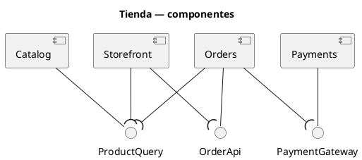
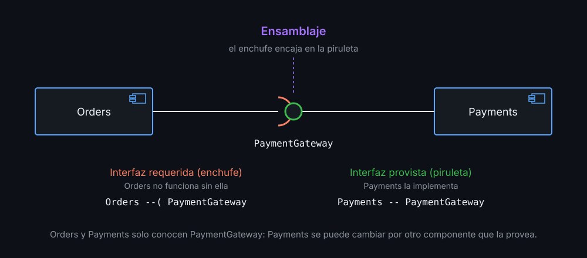
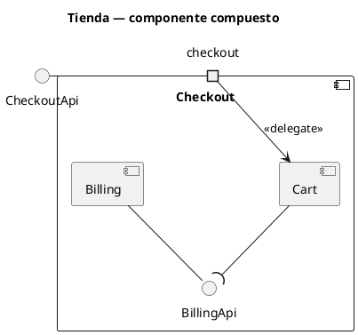

# Componentes e interfaces

Un paquete agrupa clases para entender el modelo. Un **componente** es una pieza del sistema que se puede sustituir por otra: un servicio, una biblioteca, una aplicación web. Lo que importa de él no es qué clases lleva dentro, sino qué ofrece y qué necesita. Eso son sus **interfaces**.

## Ejemplo

## Qué hay en el diagrama

- **Componente** (`component Orders`): caja con el icono de dos pestañas. El nombre dice qué parte del negocio resuelve, no la tecnología.
- **Interfaz** (`interface OrderApi`): un contrato con nombre, un conjunto de operaciones. Se declara antes de usarla.
- **Interfaz provista** (`Orders -- OrderApi`): un círculo, la "piruleta". `Orders` implementa `OrderApi` y cualquiera puede usarla.
- **Interfaz requerida** (`Storefront --( OrderApi`): un semicírculo, el "enchufe". `Storefront` no funciona si nadie le da `OrderApi`.
- **Ensamblaje**: cuando el enchufe de un componente encaja en la piruleta de otro, los dos quedan conectados sin conocerse. Puedes cambiar `Payments` por otro proveedor mientras siga ofreciendo `PaymentGateway`.

Con dos guiones (`--`) la línea va en vertical y con uno (`-`), en horizontal. Es solo colocación: el significado lo da el `(`.

## Componente frente a paquete

| | Paquete | Componente |
|---|---|---|
| Qué agrupa | Clases del modelo | Una pieza que se compila, se despliega o se sustituye |
| Qué enseña | A qué grupo pertenece cada clase | Qué ofrece y qué necesita |
| Cómo se relaciona | Dependencia `..>` | Interfaces provistas y requeridas |

Un componente suele realizar las clases de uno o varios paquetes, pero no tiene por qué coincidir uno a uno.

## Componente compuesto, puertos y delegación

Un componente puede contener otros. El **puerto** (`portin`) es el punto por el que entra la petición desde fuera, y la **delegación** dice qué parte interna la atiende:

Desde fuera solo se ve `Checkout` y su interfaz. Puedes repartir el trabajo de otra forma por dentro sin que nadie de fuera lo note.

## Errores típicos

- Unir componentes con flechas `-->` sin interfaz: dice que se conocen, no a través de qué contrato.
- Declarar la interfaz después de usarla: PlantUML crea una implícita al usarla y al declararla responde `This element (X) is already defined`.
- Dejar una interfaz requerida que nadie provee: el sistema no arranca.
- Hacer un componente por clase: eso es el diagrama de clases con otro dibujo.

<!-- nav -->
---

## 🔗 Navegación

| Anterior | Siguiente |
|---|---|
| ← [Teoría — Paquetes y dependencias](01-paquetes-y-dependencias.md) | [Teoría — Nodos y artefactos](03-nodos-y-artefactos.md) → |

[↑ Semana 08](../README.md)
