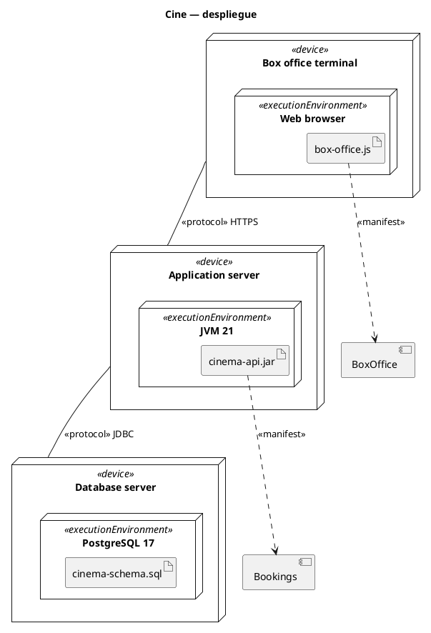
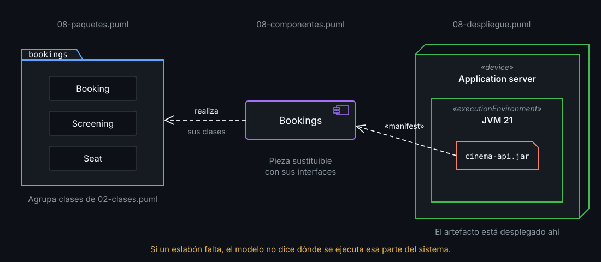

# Nodos y artefactos

El diagrama de componentes dice qué piezas tiene el sistema. El de **despliegue** dice dónde se ejecuta cada una: en qué máquinas, sobre qué software base y qué archivos se copian a cada sitio. Es el diagrama que lee quien opera el sistema.

## Ejemplo

## Qué hay en el diagrama

- **Nodo dispositivo** (`node ... <<device>>`): hardware o máquina virtual. Una caja en 3D.
- **Entorno de ejecución** (`node ... <<executionEnvironment>>`): software que aloja a otros, como una JVM, un navegador, un contenedor o un gestor de bases de datos. Va **dentro** del dispositivo que lo ejecuta.
- **Artefacto** (`artifact "cinema-api.jar"`): un archivo concreto que se instala, como un `.jar`, un `.js`, un script SQL o un fichero de configuración. Dibujarlo dentro de un nodo significa que está desplegado ahí.
- **`<<manifest>>`** (`cinemaApi ..> Bookings`): el artefacto es la forma física del componente. Une el diagrama de despliegue con el de componentes.
- **Ruta de comunicación** (`terminal -- appServer : <<protocol>> HTTPS`): línea continua entre nodos con el protocolo que usan. Sin flecha: la ruta no tiene dirección.

## Alias para nombres largos

Los nombres de los nodos llevan espacios (`"Application server"`), así que cada nodo se declara con `as` y un alias sin espacios. Las rutas y los `<<manifest>>` usan el alias: `appServer -- dbServer`. Si escribes el nombre con espacios sin comillas, PlantUML responde `Syntax Error?`.

## Tres vistas, un sistema

Una clase de `02-clases.puml` está en un paquete. Un componente agrupa el trabajo de uno o varios paquetes y se materializa en un artefacto. Ese artefacto está desplegado en un nodo. Si en algún punto la cadena se rompe (un componente que no manifiesta ningún artefacto, un artefacto fuera de todo nodo), falta una decisión en el modelo.

## Errores típicos

- Usar `database` o `cloud`: PlantUML los dibuja, pero no son UML. Un gestor de bases de datos es un `<<executionEnvironment>>` y el esquema que se instala en él es un artefacto.
- Dejar artefactos sueltos, fuera de todo nodo: no dicen dónde se ejecutan.
- Poner el componente dentro del nodo: lo que se despliega es el artefacto, y el componente se relaciona con él mediante `<<manifest>>`.
- Rutas de comunicación sin protocolo: quien opera el sistema necesita saber qué puerto abrir.

<!-- nav -->
---

## 🔗 Navegación

| Anterior | Siguiente |
|---|---|
| ← [Teoría — Componentes e interfaces](02-componentes-e-interfaces.md) | [Índice de labs](../2-practicas/README.md) → |

[↑ Semana 08](../README.md)
