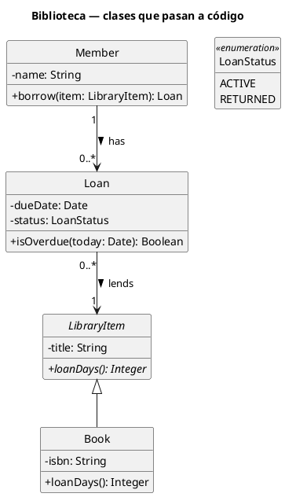
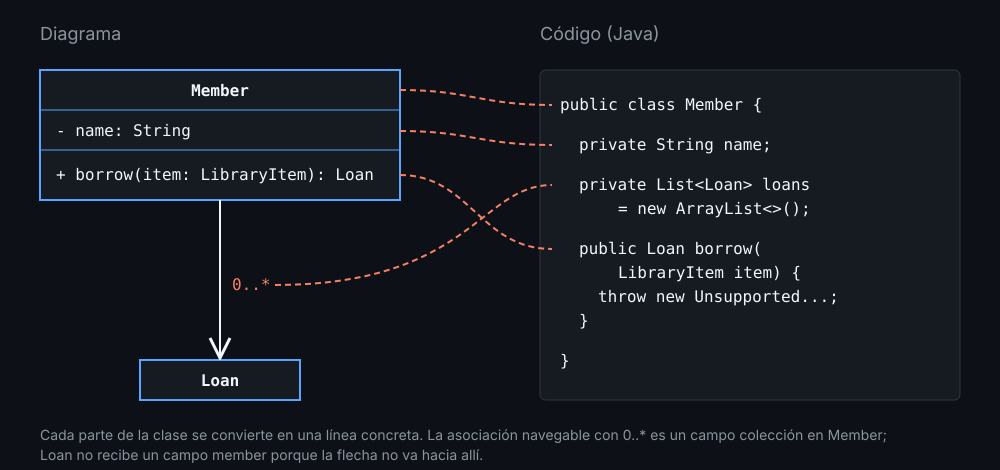

# Del diagrama al código

Un diagrama de clases bien hecho se traduce a código casi sin decisiones: cada elemento UML tiene su equivalente en cualquier lenguaje orientado a objetos. Escribir ese **esqueleto** (clases, campos y firmas, sin lógica) es la prueba de que el diagrama dice lo suficiente. Si al escribirlo dudas, al diagrama le falta información.

## Ejemplo



En Java:

```java
public class Member {
    private String name;
    private final List<Loan> loans = new ArrayList<>();   // --> "0..*" Loan

    public Loan borrow(LibraryItem item) {
        throw new UnsupportedOperationException("sin implementar");
    }
}

public class Book extends LibraryItem {                  // LibraryItem <|-- Book
    private String isbn;

    @Override
    public int loanDays() { return 21; }
}
```

En Python:

```python
class Member:
    def __init__(self, name: str):
        self._name = name
        self._loans: list[Loan] = []                     # --> "0..*" Loan

    def borrow(self, item: "LibraryItem") -> "Loan":
        raise NotImplementedError


class Book(LibraryItem):                                 # LibraryItem <|-- Book
    def __init__(self, title: str, isbn: str):
        super().__init__(title)
        self._isbn = isbn

    def loan_days(self) -> int:
        return 21
```

## Tabla de traducción

| UML | Código |
|---|---|
| Clase con atributos y operaciones | Clase con campos y métodos |
| `-` / `+` / `#` / `~` | `private` / `public` / `protected` / de paquete. Python: `_nombre` para lo que no es público |
| `{static}` | `static`; en Python, atributo de clase o `@staticmethod` |
| `{abstract}` y `abstract class` | `abstract`; en Python, `ABC` y `@abstractmethod` |
| `interface X <<interface>>` | `interface`; en Python, una clase `ABC` o `Protocol` |
| `enum X <<enumeration>>` | `enum`; en Python, `class X(Enum)` |
| Generalización `A <\|-- B` | `class B extends A`; en Python, `class B(A)` |
| Realización `I <\|.. C` | `class C implements I`; en Python, `class C(I)` |
| Asociación navegable `A --> "1" B` | Campo de tipo `B` en `A` |
| Multiplicidad `0..*` o `1..*` | Colección: `List<B>`, `list[B]` |
| Multiplicidad `0..1` | Campo que puede ser `null` o `None` |
| Composición `A *-- B` | `A` crea `B` dentro y no la entrega fuera |
| Dependencia `A ..> B` | `B` aparece solo como parámetro o variable local, nunca como campo |



## La navegabilidad decide quién tiene el campo

`Member "1" --> "0..*" Loan` dice que el socio conoce sus préstamos, así que `Member` tiene la lista. El préstamo no tiene un campo `member`, porque la flecha no va hacia allí. Una asociación sin flechas te obliga a decidir: si pones el campo en los dos lados, mantenlos sincronizados o tendrás un socio con un préstamo que no apunta a él.

## Nombres y tipos

- Los nombres del diagrama se respetan. Si tu lenguaje usa `snake_case`, `dueDate` pasa a `due_date`, pero no se convierte en `fecha`.
- Los tipos UML (`String`, `Integer`, `Date`) se traducen al tipo más cercano de tu lenguaje: `Date` a `LocalDate` o `date`, `Decimal` a `BigDecimal` o `Decimal`.
- Los getters, setters y constructores no se dibujan en el diagrama de clases: los añades en el código si tu lenguaje los necesita.

## Errores típicos

- Añadir en el código clases que el diagrama no tiene. Si hacen falta, primero van al diagrama.
- Poner un campo para una dependencia: la dependencia es de uso puntual, no de estructura.
- Usar herencia para reutilizar código cuando el diagrama dice asociación.
- Escribir la lógica completa. En esta semana basta con las firmas: el cuerpo lanza una excepción o devuelve un valor fijo.

<!-- nav -->
---

## 🔗 Navegación

| Anterior | Siguiente |
|---|---|
| ← [Semana 09 — De UML a código y patrones](../README.md) | [Teoría — Del código al diagrama](02-del-codigo-al-diagrama.md) → |

[↑ Semana 09](../README.md)
