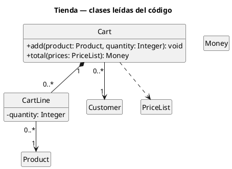
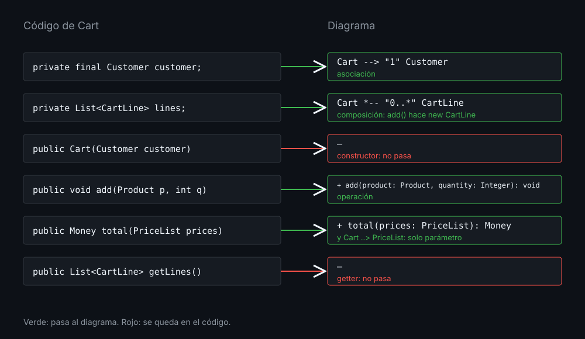

# Del código al diagrama

El camino inverso, de código a diagrama, se llama **ingeniería inversa**. Lo harás cuando llegues a un proyecto sin documentación o quieras comprobar que el código sigue al modelo. Hay herramientas que dibujan una caja por clase, pero el resultado es un listado, no un modelo: incluye todo y no decide nada. Hacerlo a mano te obliga a decidir qué importa.

## Ejemplo

```java
public class Cart {
    private final Customer customer;
    private final List<CartLine> lines = new ArrayList<>();

    public Cart(Customer customer) {
        this.customer = customer;
    }

    public void add(Product product, int quantity) {
        lines.add(new CartLine(product, quantity));
    }

    public Money total(PriceList prices) { ... }

    public List<CartLine> getLines() { return List.copyOf(lines); }
}
```



## Qué buscar en cada clase

| En el código | En el diagrama |
|---|---|
| `extends` / `class B(A)` | Generalización `A <\|-- B` |
| `implements` / clase base abstracta usada como contrato | Realización `I <\|.. C` |
| Campo de tipo de otra clase del dominio | Asociación navegable `-->` hacia esa clase, con multiplicidad `1` (o `0..1` si puede ser `null`) |
| Campo colección (`List<X>`, `list[X]`, `Set<X>`) | Asociación hacia `X` con multiplicidad `0..*` |
| La clase crea la parte con `new` y no la comparte | Composición `*--` |
| La parte llega de fuera por el constructor o un setter | Asociación simple: alguien más también la conoce |
| Tipo que solo aparece en parámetros o variables locales | Dependencia `..>` |
| Campo de tipo primitivo o de la biblioteca estándar | Atributo: `- quantity: Integer` |

Un campo de tipo de otra clase del dominio se dibuja como asociación, no como atributo. Si `Cart` tuviera `- customer: Customer` y además la línea `Cart --> Customer`, el diagrama diría lo mismo dos veces.



## Qué no está en el código

El código no guarda todo lo que el modelo sabe. Estas decisiones las tomas tú, y cada una lleva un comentario `'` en el `.puml`:

- **Límites de multiplicidad:** una lista puede estar vacía o no según una regla que vive en un `if` lejano. `0..*` es la lectura segura; `1..*` necesita la regla.
- **Agregación frente a asociación:** en el código son idénticas. Si no hay creación interna, dibuja asociación.
- **Nombre y sentido de lectura de la asociación:** el código solo tiene el nombre del campo.
- **Bidireccionalidad:** dos campos, uno en cada clase, son la misma asociación navegable en los dos sentidos, no dos asociaciones.

## Qué no pasa al diagrama

- Getters, setters, `toString`, `equals` y constructores. El diagrama de clases muestra responsabilidades, no código repetitivo.
- Métodos privados auxiliares. Si hacen algo importante, probablemente son una operación pública de otra clase.
- Clases de la biblioteca estándar (`ArrayList`, `LocalDate`) y del framework. Aparecen como tipos, no como cajas.
- Clases de infraestructura (DTO, controladores, repositorios) en un diagrama del dominio. Si las necesitas, van en otro diagrama.

## Errores típicos

- Copiar todos los campos como atributos, incluidos los que son referencias a otras clases.
- Dibujar `List` como una clase con una asociación hacia ella.
- Elegir composición porque el campo es `final`. Que no cambie la referencia no significa que el carrito sea dueño del cliente.

<!-- nav -->
---

## 🔗 Navegación

| Anterior | Siguiente |
|---|---|
| ← [Teoría — Del diagrama al código](01-del-diagrama-al-codigo.md) | [Teoría — Patrones GoF en UML](03-patrones-gof-en-uml.md) → |

[↑ Semana 09](../README.md)
