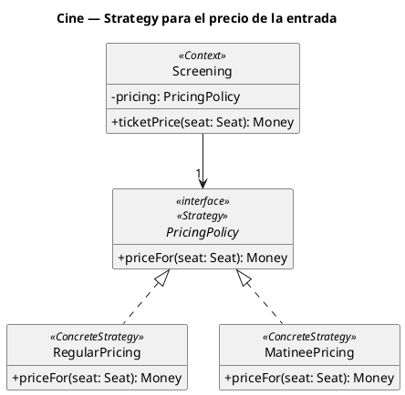
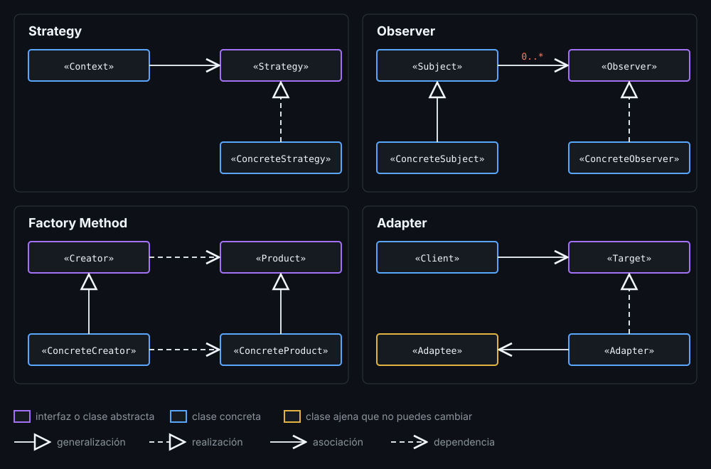

# Patrones GoF en UML

Un **patrón de diseño** es una solución con nombre a un problema que se repite. El catálogo de Gamma, Helm, Johnson y Vlissides (*Design Patterns*, 1994, los "Gang of Four" o GoF) describe 23. Cada patrón define unos **roles**: las piezas que tiene que haber y cómo se relacionan. Al aplicarlo a tu dominio, cada rol lo cumple una clase tuya.

En el diagrama, el rol se escribe como **estereotipo** junto al nombre de la clase: `class Screening <<Context>>`. Una interfaz lleva los dos: `interface PricingPolicy <<interface>> <<Strategy>>`.

## Strategy

**Problema:** una clase tiene varias formas de hacer lo mismo y elige con un `if` o un `switch` que crece cada vez que aparece una forma nueva.
**Solución:** cada forma es una clase que cumple una interfaz común, y el contexto la recibe ya elegida.

## Observer

**Problema:** cuando algo cambia en un objeto, otros tienen que enterarse, y el objeto no debería saber quiénes son.
**Solución:** el sujeto guarda una lista de observadores que cumplen una interfaz y los avisa a todos.

| Rol | Qué hace | Cine |
|---|---|---|
| `Subject` | Registra observadores y los avisa (`attach`, `notifyAll`) | `Screening` |
| `Observer` | Interfaz con la operación de aviso (`update`) | `ScreeningObserver` |
| `ConcreteObserver` | Reacciona al aviso | `WaitingList`, `BoxOfficeDisplay` |

El sujeto se relaciona con la interfaz: `Screening --> "0..*" ScreeningObserver`. `ConcreteSubject` aparece cuando el sujeto es abstracto y hay varios concretos.

## Factory Method

**Problema:** una clase necesita crear objetos, pero cuál crear depende de la subclase.
**Solución:** la creación es una operación abstracta que cada subclase implementa.

| Rol | Qué hace | Biblioteca |
|---|---|---|
| `Creator` | Declara `{abstract} + createItem(): LibraryItem` y lo usa | `Catalog` |
| `ConcreteCreator` | Implementa la creación | `BookCatalog`, `DvdCatalog` |
| `Product` | Lo que se crea, interfaz o clase abstracta | `LibraryItem` |
| `ConcreteProduct` | Lo que crea cada `ConcreteCreator` | `Book`, `Dvd` |

El creador depende del producto: `Catalog ..> LibraryItem`. Cada creador concreto, del suyo: `BookCatalog ..> Book`.

## Adapter

**Problema:** tienes una clase que hace lo que necesitas, pero con una interfaz distinta de la que espera tu código, y no puedes cambiarla porque es de otro.
**Solución:** una clase intermedia cumple la interfaz esperada y traduce las llamadas.

| Rol | Qué hace | Tienda |
|---|---|---|
| `Client` | Usa la interfaz que conoce | `Checkout` |
| `Target` | La interfaz que espera el cliente | `PaymentGateway` |
| `Adapter` | Cumple `Target` y llama al adaptado | `AcmePayAdapter` |
| `Adaptee` | La clase ajena que no puedes cambiar | `AcmePayClient` |

`Checkout --> PaymentGateway`, `PaymentGateway <|.. AcmePayAdapter` y `AcmePayAdapter --> "1" AcmePayClient`.

## Cuándo no usar un patrón

Un patrón añade clases. Si solo hay una forma de calcular el precio, una operación basta. Aplícalo cuando el problema ya está en tu diagrama: un enum que decide comportamiento, una clase que avisa a otras con llamadas directas, un sistema externo con otra interfaz.

## Errores típicos

- Escribir los roles con otro nombre (`<<ConcreteStrategyA>>`, `<<Estrategia>>`): el rol es el del catálogo.
- Que el contexto apunte a una estrategia concreta en lugar de a la interfaz: el patrón desaparece.
- Aplicar un patrón a clases inventadas para el ejemplo. Al menos una pieza tiene que ser una clase que ya existía en tu modelo.

<!-- nav -->
---

## 🔗 Navegación

| Anterior | Siguiente |
|---|---|
| ← [Teoría — Del código al diagrama](02-del-codigo-al-diagrama.md) | [Índice de labs](../2-practicas/README.md) → |

[↑ Semana 09](../README.md)
