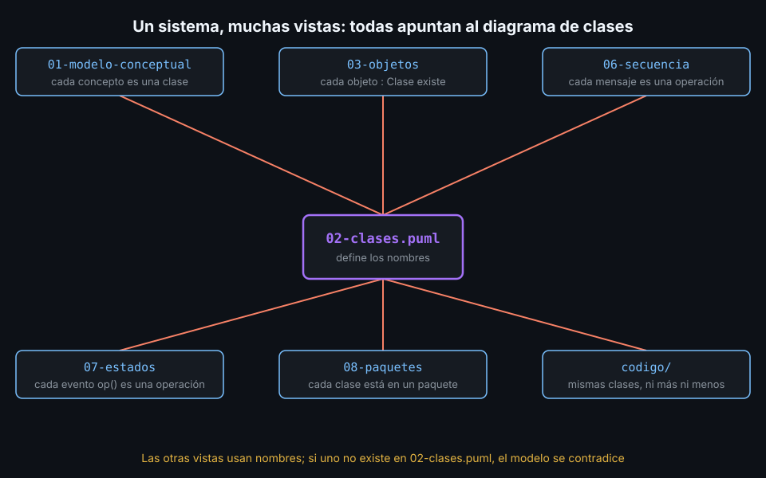
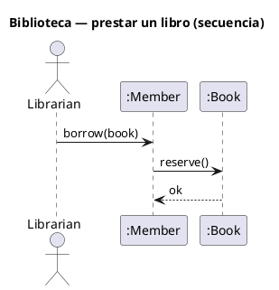
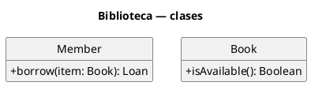

# Coherencia entre vistas

Tu modelo tiene doce diagramas, pero describe **un solo sistema**. Cada vista mira el mismo sistema desde otro ángulo: la estructura (clases), el uso (casos de uso), el tiempo (secuencia), el ciclo de vida (estados) y la organización (paquetes y código). Un modelo es **coherente** cuando ninguna vista contradice a otra: lo que una vista nombra, existe en la vista que lo define.



## El diagrama de clases es el centro

Casi todas las reglas apuntan al diagrama de clases, porque es la vista que **define** los nombres que las demás **usan**:

| Vista | Usa | Regla |
|---|---|---|
| Modelo conceptual | conceptos del negocio | Cada concepto es una clase de `02-clases.puml` |
| Objetos | `objeto : Clase` | Cada objeto es instancia de una clase que existe |
| Secuencia | mensajes a lifelines `:Clase` | Cada mensaje síncrono llama a una operación de esa clase |
| Estados | eventos `op()` | Cada evento con paréntesis es una operación de la entidad |
| Paquetes | clases dentro de paquetes | Cada clase está en algún paquete |
| Código | clases y campos | Las mismas clases, ni una más ni una menos |

Los eventos de tiempo (`when(...)`, `after(...)`) no son operaciones: los dispara el reloj, no una llamada.

## Una incoherencia típica

La secuencia de "prestar un libro" de una biblioteca:



Y el diagrama de clases:



Los dos renderizan y cada uno, por separado, parece correcto. Juntos se contradicen: `Book` no tiene `reserve()`. O falta la operación en el diagrama de clases, o el mensaje debía ser `isAvailable()`. Decidir cuál es la mitad del trabajo; la otra mitad es encontrarlo.

## Encontrarlas con comandos

A ojo, entre doce diagramas, se escapan. Con `grep` y `comm` se encuentran en segundos. Las clases de un diagrama:

```bash
grep -oE '^[[:space:]]*(abstract[[:space:]]+)?(class|enum|interface)[[:space:]]+[A-Za-z0-9_]+' 02-clases.puml | awk '{print $NF}' | sort -u
```

Las operaciones (`+ nombre(`):

```bash
grep -oE '[+#~-][[:space:]]*[a-z][A-Za-z0-9_]*[(]' 02-clases.puml | grep -oE '[a-z][A-Za-z0-9_]*' | sort -u
```

Con dos listas ordenadas, `comm -23 a b` imprime lo que está en `a` y no en `b`. Si no imprime nada, las vistas cuadran. Los labs 01 y 02 montan estas comparaciones vista a vista.

## Qué corregir primero

Cuando dos vistas se contradicen, no corrijas la que tengas más a mano. Pregúntate cuál dice la verdad del dominio:

- Si la secuencia descubrió una operación que el sistema necesita, **añádela al diagrama de clases**. Es lo habitual: la secuencia piensa en el tiempo y encuentra lo que faltaba.
- Si el nombre de la secuencia es un despiste, **corrige el mensaje**.
- Si una clase sobra en todas las vistas menos en una, probablemente **sobra**.

Cada corrección se apunta: es la materia prima de la revisión por pares y de la defensa.

<!-- nav -->
---

## 🔗 Navegación

| Anterior | Siguiente |
|---|---|
| ← [Semana 10 — Proyecto integrador](../README.md) | [Teoría — Trazabilidad](02-trazabilidad.md) → |

[↑ Semana 10](../README.md)
