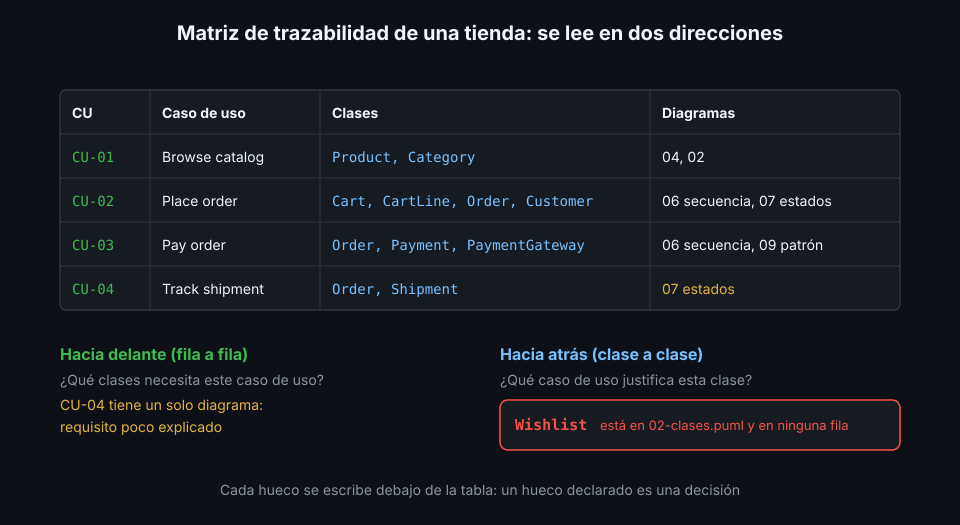

# Trazabilidad

La coherencia comprueba que las vistas no se contradicen. La **trazabilidad** comprueba que no falta nada: que cada requisito llega hasta las piezas que lo cumplen y que cada pieza existe por algún requisito. En un modelo UML, los requisitos son los **casos de uso**.

## La matriz

Una tabla con una fila por caso de uso. Para una tienda online:

| CU | Caso de uso | Clases | Diagramas |
|---|---|---|---|
| CU-01 | Browse catalog | `Product`, `Category` | 04, 02 |
| CU-02 | Place order | `Cart`, `CartLine`, `Order`, `Customer` | 06 secuencia, 07 estados |
| CU-03 | Pay order | `Order`, `Payment`, `PaymentGateway` | 06 secuencia, 09 patrón |
| CU-04 | Track shipment | `Order`, `Shipment` | 07 estados |

En tu `trazabilidad.md`, cada nombre de la columna Diagramas es un enlace al archivo de `diagramas/`.



## Se lee en dos direcciones

**Hacia delante**, fila a fila: "¿qué necesito para cumplir este caso de uso?". Una fila sin clases es un requisito que el modelo no sabe cumplir. Una fila con un solo diagrama es un requisito poco explicado: está en el diagrama de casos de uso y nada más.

**Hacia atrás**, clase a clase: "¿qué caso de uso justifica esta clase?". Si `Wishlist` está en `02-clases.puml` pero en ninguna fila, o falta un caso de uso ("Save for later"), o la clase sobra. Las dos respuestas son válidas; no decidir no lo es.

## Qué clases van en cada fila

Las que el caso de uso **toca**: las que crea, modifica o consulta para llegar a su postcondición. Para decidirlas, recorre su especificación `CU-NN.md` paso a paso o su secuencia, si la tiene. Las enumeraciones también cuentan: si "Place order" deja el pedido en `OrderStatus.PLACED`, `OrderStatus` va en la fila.

No pongas todas las clases en todas las filas para cubrir el expediente. Una matriz donde todo toca todo no dice nada, y el instructor lo ve en la defensa.

## Comprobarla

Las filas, contra los alias del diagrama de casos de uso:

```bash
grep -oE 'as[[:space:]]+CU[0-9]{2}' diagramas/04-casos-de-uso.puml | grep -oE '[0-9]{2}' | sort -u
grep -oE '^[|][[:space:]]*CU-[0-9]{2}' trazabilidad.md | grep -oE '[0-9]{2}' | sort -u
```

Las dos listas tienen que ser iguales. Las clases de la columna 4 (`awk -F'|'` cuenta como campo 1 lo que hay antes de la primera barra):

```bash
awk -F'|' '$2 ~ /CU-[0-9]/ {print $4}' trazabilidad.md | grep -oE '`[A-Z][A-Za-z0-9_]*`' | tr -d '`' | sort -u
```

Compáralas con `comm` contra las clases de `02-clases.puml`: lo que solo está en el diagrama son clases huérfanas. El lab 03 construye la matriz completa.

## Los huecos se escriben

Una matriz honesta tiene huecos: un caso de uso sin secuencia, una clase que solo aparece en uno. Debajo de la tabla, una sección "Huecos que deja la matriz" los nombra y dice qué diagrama los cubriría. Un hueco declarado es una decisión; uno escondido es un error que encuentra otro.

<!-- nav -->
---

## 🔗 Navegación

| Anterior | Siguiente |
|---|---|
| ← [Teoría — Coherencia entre vistas](01-coherencia-entre-vistas.md) | [Teoría — Revisión por pares y defensa](03-revision-y-defensa.md) → |

[↑ Semana 10](../README.md)
