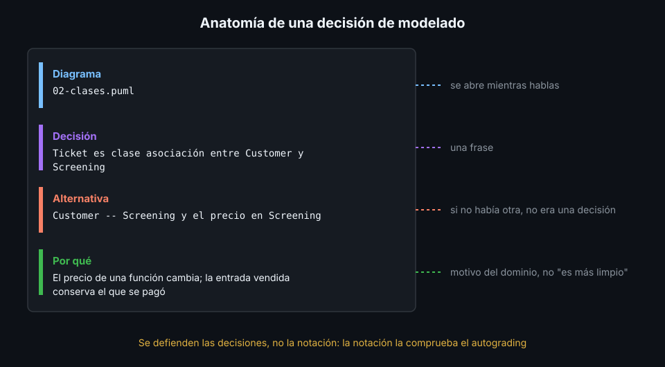
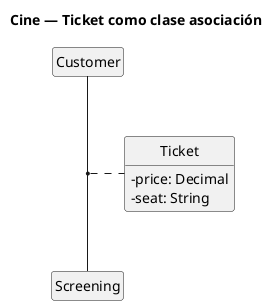

# Revisión por pares y defensa

Los comandos encuentran las contradicciones que se pueden contar. Las que no se pueden contar (una composición que debía ser asociación, una clase que hace de todo, un caso de uso que nadie pidió) las encuentra **otra persona**. Por eso el modelo pasa por una revisión antes de defenderse.

## La revisión por pares

Cambias tu modelo con un compañero **de otro dominio**. No conoce tu negocio, así que todo lo que no entienda sin preguntarte es un hallazgo: si a él no le queda claro, al lector del modelo tampoco.

El revisor recorre el modelo con esta lista, en este orden:

1. **Lee el README**: dominio, actores y glosario. Sin esto, el resto no se entiende.
2. **Casos de uso**: ¿cada actor tiene algo que hacer? ¿Hay casos de uso que son pasos de otro ("Click button")?
3. **Clases**: ¿alguna clase con más de diez operaciones? ¿Composiciones donde la parte sobrevive al todo? ¿Multiplicidades que el dominio no permite?
4. **Una vista de comportamiento** (secuencia o estados): ¿se puede seguir sin preguntar?
5. **Coherencia**: elige tres nombres de la secuencia o de los estados y búscalos en el diagrama de clases.

Cada hallazgo es una fila de `revision.md`: dónde (con enlace), qué ve el revisor y, al final, tu **resolución**. Una resolución empieza por una de tres palabras:

| Resolución | Cuándo | Ejemplo |
|---|---|---|
| **Corregido** | El revisor tiene razón | Corregido: `Seat` ya no es composición de `Screening`; los asientos son de la sala |
| **Se mantiene** | Tienes un motivo del dominio | Se mantiene: `Ticket` guarda el precio porque el precio de la función cambia después de vender |
| **Pendiente justificado** | Tiene razón pero no cabe en esta entrega | Pendiente justificado: falta la secuencia de "Refund ticket"; anotado en la trazabilidad |

"Se mantiene" sin motivo no es una resolución. Discutir un hallazgo está bien; ignorarlo, no.

## La defensa

En la defensa enseñas el modelo al instructor en **10 minutos** y respondes preguntas. No se defiende la notación (eso lo comprueba el autograding), se defienden las **decisiones**.

Una decisión de modelado tiene cuatro partes:

- **Diagrama**: dónde se ve. El instructor lo abre mientras hablas.
- **Decisión**: qué modelaste, en una frase.
- **Alternativa**: qué otra forma razonable había. Si no había alternativa, no era una decisión.
- **Por qué**: el motivo **del dominio** que inclina la balanza. "Porque es más limpio" no es un motivo; "porque un mismo cliente compra entradas para varias funciones y cada entrada tiene su precio" sí.

En un cine:

La alternativa era una asociación `Customer -- Screening` con el precio en `Screening`. Se descarta porque las funciones cambian de precio (estreno, día del espectador) y una entrada vendida conserva el que pagó.

## El guion

Diez minutos dan para cinco paradas. Un orden que funciona: dominio y restricción propia, casos de uso con la matriz de trazabilidad, clases, un caso de uso en secuencia y estados, y lo que cambió tras la revisión. Cada parada enlaza el diagrama que se abre.

Prepara dos preguntas que esperas que te hagan, con tu respuesta corta. Casi siempre caen sobre la clase con más relaciones o sobre la composición más discutible.

<!-- nav -->
---

## 🔗 Navegación

| Anterior | Siguiente |
|---|---|
| ← [Teoría — Trazabilidad](02-trazabilidad.md) | [Índice de labs](../2-practicas/README.md) → |

[↑ Semana 10](../README.md)
